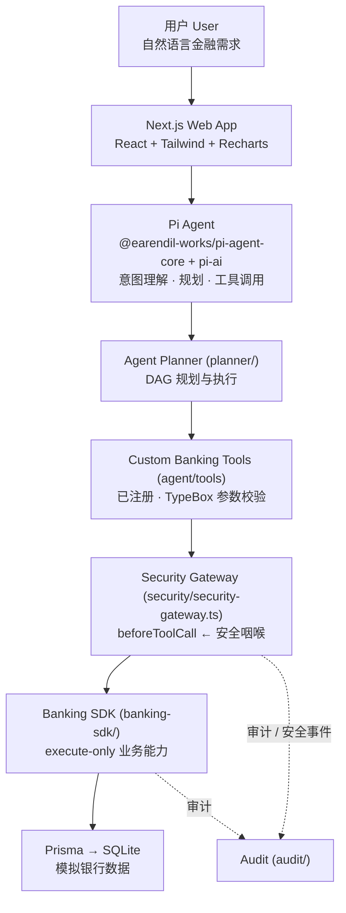
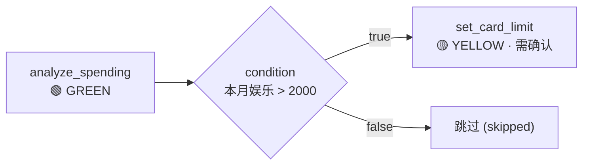
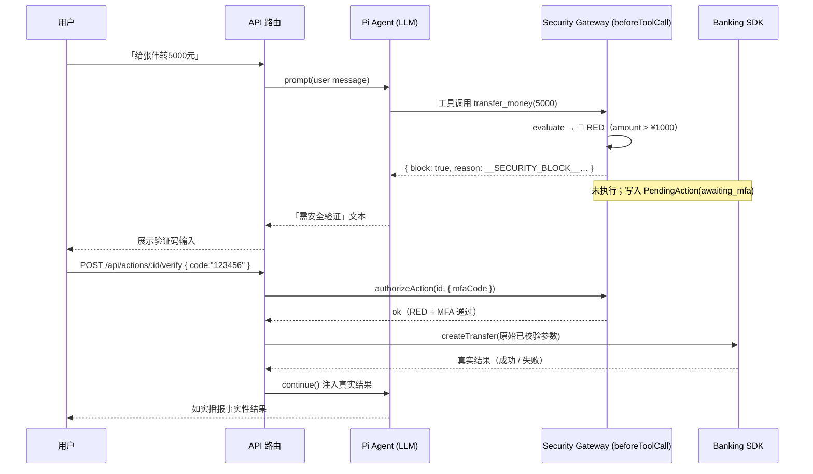

# 架构文档 · AI Banking Agent Architecture

确认链路和恢复重放共用 SDK 写事务内的操作/计划/会话熔断围栏；工具错误归一化后仍保留策略拒绝的
`CIRCUIT_OPEN`，避免落为错误的交易终态。恢复授权在事务认领后重读风险，恢复落地事务以当前持久化
授权构建审计和返回元数据。前端及确认接口仅为显式待决策状态生成 MFA 事件，保留下一节点的独立事件。

恢复入口有两条执行边界：核验已提交凭证后只读回填；无凭证且可能首次转账时进入 `security/recovery-authorization.ts`，复核当前授权，并通过 SDK 事务内围栏再次检查熔断。卡片/订阅写操作由工具层传入服务端身份，SDK 用所有者条件保护实际写入。执行审计 `exec:<actionId>` 与人工核对事件 `reconcile:<actionId>` 分开去重，避免审计冲突阻止状态收敛。

> 一个**比赛演示（competition demo）**级的 *AI 银行智能体*：用户用自然语言描述一个金融需求，
> 智能体理解意图、规划任务、调用**银行工具**，并在一个**由代码强制、模型不可篡改**的权限与
> 安全模型下完成操作。核心不变式：
>
> **智能体可以决定「下一步做什么（what to do next）」；智能体永远不能决定「它是否有权限去做（whether it is allowed）」。**
> 权限由 TypeScript 代码判定，绝不来自 LLM。

---

## 1. 概述 Overview

系统实现了一个完整的智能体循环：

**理解 → 规划 → 执行 → 风控 → 验证 → 审计**
(understand → plan → execute → risk-control → verify → audit)

它**不是**一个套在银行 App 外层的聊天皮肤，而是一个具备**自主规划、工具调用、安全网关、
任务编排与审计**能力的智能体。范围被严格限制在演示沙箱内：**没有真实银行、没有真实资金、
没有真实支付、没有 shell、模型也不能进行任意代码 / SQL / 文件访问**；所有银行数据都在
SQLite 中模拟。

---

## 2. 分层流水线 · Layered Pipeline

请求自顶向下穿过各层，越往下越接近数据，越往上越接近用户：



**各层职责（自顶向下）**

| 层 | 位置 | 职责 | 不做什么 |
|---|---|---|---|
| Web App | `app/`, `components/` | 页面、SSE 聊天、卡片、确认/验证按钮；只做「渲染 + 路由」 | 不含业务逻辑、不直接访问 Prisma |
| Pi Agent | `agent/` | Agent **运行时 + 规划器 + 工具调用器**；意图理解、上下文、自然语言回复 | 不判定权限、不移动资金 |
| Agent Planner | `planner/` | 纯 DAG 逻辑：校验 → 拓扑排序 → 执行 → 条件求值 → 状态流 | 不含银行/安全/DB 行为（副作用全部注入） |
| Banking Tools | `agent/tools/` | 智能体**唯一**的能力面：26 个已注册工具，参数为 TypeBox schema | 不判定权限 |
| Security Gateway | `security/` | 对每个工具调用给出 🟢/🟡/🔴 + 确认 / MFA / 熔断 | **不执行业务操作**（只授权） |
| Banking SDK | `banking-sdk/` | 唯一把银行意图变成 Prisma 写入的层；执行领域校验 | 不做权限 / 确认 / MFA / 限额判定 |
| Persistence | `prisma/`, `lib/db/` | Prisma + SQLite 模拟数据，仓储层 `lib/db/repositories/*` | — |

依赖方向严格单向向下：`lib` ← `banking-sdk` ← `agent`/`planner`/`audit`；`security` 依赖 `lib`
（+ 注入端口）；`app`/`components` 依赖下面的一切。**无跨模块循环依赖。**

**Next.js 表面（HTTP 路由处理器 + 页面）**

- **API 路由处理器**（`app/api/**/route.ts`，共 16 个）：`/api/actions`、`/api/actions/[id]/confirm`、
  `/api/actions/[id]/verify`、`/api/actions/[id]/cancel`、`/api/actions/[id]/recover`、`/api/audit`、`/api/bills`、`/api/cards`、
  `/api/chat`、`/api/dashboard`、`/api/health`、`/api/security`、`/api/security/reset`、
  `/api/subscriptions`、`/api/tasks`、`/api/tasks/[id]`。
- **页面**（`app/**/page.tsx`，共 8 个）：`/`（dashboard）、`/actions`（待处理操作）、`/agent`、`/audit`、`/bills`、`/cards`、
  `/security`、`/subscriptions`；另有 Next 生成的 `/_not-found`。

> **构建前置（Build prerequisite）**：`next build`（Next ^15.1.6）会**静态预渲染**依赖数据库的页面
> （`/`、`/cards`、`/subscriptions` 在模块作用域导入 `@/banking-sdk`），因此必须在构建**之前**先推送并
> 填充数据库：`npm run db:push` → `npm run db:seed` → `npm run build`（`npm run db:push` = `tsx scripts/db-push.ts`，为 Prisma schema-engine 子进程固定 `RUST_LOG=info`）。
> 按请求动态渲染的页面是 agent / audit / security / bills；`app/api/**` 处理器全部为动态。

> **UI 组件 barrel 中立性（SSR）**：barrel 层**不得**带 `'use client'`；一个带该指令的**中间层** barrel
> 若经中立的 `components/index.ts` 门面星号再导出，SSR 时会解析为 `undefined` 并让消费页崩溃——
> 只有**叶子**客户端组件带该指令。

---

## 3. 空间维度 · Context Tree 目录布局

仓库本身是一棵 **Context Tree**：每个目录都有一份 `CONTEXT.md`，既是文档（Intent / API Surface /
Constraints），也是**路由表**（把领域映射到子目录）。顶层节点职责：

| 节点 | 职责 |
|---|---|
| `./app` | Next.js App Router：页面（dashboard / agent chat / bills / cards / subscriptions / security / audit / actions 待处理操作）+ API 路由处理器（chat SSE、actions confirm\|verify\|cancel\|recover、tasks 控制、audit、security、read models） |
| `./components` | React UI：聊天卡片、图表、银行瓦片、UI 原语 |
| `./agent` | Pi Agent 运行时：agent 装配、system prompt、会话存储、工具注册、LLM provider（live + faux）、确认续跑 |
| `./planner` | DAG 任务规划器 + 执行器（`submit_plan` 的后端） |
| `./banking-sdk` | 银行能力（account / transaction / transfer / card / subscription / investment / task / budget），execute-only，基于 Prisma |
| `./security` | 安全网关 + 权限引擎、风险引擎、MFA、熔断器、注入守卫（安全咽喉） |
| `./audit` | 审计日志器 + 安全事件记录器 |
| `./lib` | 共享内核：contracts、errors、money、config、constants、clock、Prisma client + repositories |
| `./prisma` | Prisma schema + 种子数据（无 `migrations/` 目录；schema 由 `prisma db push` 推送） |
| `./tests` | 自动化测试（四层）：纯单元测试（security/planner/sdk/agent/lib）+ `tests/scenarios/` 的 faux-LLM 全流水线场景测试（Tests 1–12）+ `tests/app/*` 与 `tests/review-*.test.ts` 的进程内 HTTP 路由处理器 `[integration]` 测试 + `tests/e2e/` 的**真实浏览器验收 harness**（`playwright-core` 启动系统 Chrome，`tsx` 显式运行，非 Vitest） |
| `./docs` | 本目录：参赛文档（architecture / security / test-cases / known-risks） |

---

## 4. 时间维度 · Git DAG（版本即状态）

代码通过一棵**不可变提交的 Git DAG**演进。一个智能体的状态是
`(node_path, base_commit, current_commit, objective)` 四元组；**部分进展也被接受**——
只要一个版本让代码库变得更好（哪怕仍有部分损坏）即算数。智能体是**瞬态**的：没有持久记忆，
所有持久记忆要么存在 Context Tree 的 `CONTEXT.md`，要么存在 Git 历史（Git 就是变更日志）。
子智能体从父节点提交的 SHA 分支，拥有独立隔离的 worktree，因此**并行智能体互不冲突**。

---

## 5. 深入 · Pi Agent（运行时 + 规划器 + 工具调用器）

Pi Agent 严格地被当作 **Agent Runtime + Planner + Tool Caller** 使用，它是本仓库中**唯一**
与 `@earendil-works/pi-agent-core` / `@earendil-works/pi-ai` 对话的节点（`agent/`）。

- 用**仅注册的银行工具**构造 Agent——**没有** bash / shell / write / edit / file / SQL 工具被注册，
  因此一段要求「给我一个 shell/SQL 工具」的注入攻击**根本没有工具可调**。
- Pi 1.1 使用 `@earendil-works/pi-agent-core` / `@earendil-works/pi-ai`；`resolveProvider()` 返回模型及绑定 provider 集合的 `streamFn`，无全局注册或临时兼容层。
- 关键 SDK 事实（对照 pi-agent-core 1.1.0 验证）：
  - `new Agent({ initialState, streamFn, beforeToolCall, afterToolCall, convertToLlm, transformContext, sessionId, ... })`
  - `AgentTool<TParams>` = `{ name, description, parameters (TypeBox), label, execute(...) }`；
    `execute` 成功返回 `AgentToolResult<T>`，失败时**抛出异常**。
  - `agent.prompt(input)` / `agent.continue()` 在 run 结束时返回；`agent.subscribe(listener)` 流式推送 `AgentEvent`。
  - **`beforeToolCall` 是安全咽喉。** 返回 `{ block: true, reason }` 会阻止执行，并向模型发出一个
    错误工具结果。🟢/🟡/🔴 正是**在代码里**这样被强制的：模型**字面上无法**执行一个被门控的工具。
  - `AgentState`（`systemPrompt` / `model` / `tools` / `messages`）可 JSON 序列化 → 按会话持久化。
  - `fauxProvider()`（来自 pi-ai）提供脚本化的内存模型，用于**离线/模拟 LLM 模式**与全部智能体测试：
    同一套 Agent / 工具 / 安全流水线，只有模型被脚本化。

**不变式**：模型提出「下一步做什么」，但每个工具调用都要穿过 `beforeToolCall →
securityGateway.handleToolCall`；被门控的工具会被阻断、其参数被持久化为 `PendingAction`，
**资金只有在人工确认之后才会移动**。模型的文本永远无法触发一次执行。

真实集成类型（`agent/`）包括：`BankingAgentRuntime`、`SessionSnapshot`、`ToolRegistry`、
`ToolExecutionResult`、`runTurn` / `resumeTurn`、`confirmAction` / `verifyAction` / `cancelAction`、
`resolveProvider`（live/mock 模型及流函数选择）、`resolveModel`（模型检查）等。

---

## 6. 深入 · Banking SDK（execute-only 业务能力）

`banking-sdk/` 是**唯一把银行意图变成 Prisma 写入**的层。每个模块都是一组基于共享仓储
（`lib/db/repositories/*`）的普通 `async` 领域函数，读写
`Account`、`Transaction`、`Contact`、`Card`/`CardLimit`、`Subscription`、
`InvestmentProduct`/`InvestmentHolding`、`Budget`、`ScheduledTask`。

- **execute-only（只执行，不决策）**：它强制*领域不变式*（余额充足、产品 `minAmount`、收款人解析、
  状态转移），并执行读写——但**不做任何权限、确认、MFA 或日限额判定**。那些由 Security Gateway 决定。
  **SDK 是机制（mechanism）；`security/` 是策略（policy）。**
- 返回**纯视图模型**（`banking-sdk/types.ts`）——Prisma 模型类型绝不泄漏出 SDK。
- 门面：`banking = { account, transaction, transfer, contact, card, subscription, investment, budget, task, dashboard }`。
- 领域校验：`transfer.createTransfer` 解析收款人（`contactId` | `phone` | `name`）；姓名匹配多个联系人时
  抛 `AppError('CONFLICT')`（携带 `detail.candidates`）；资金不足抛 `INSUFFICIENT_FUNDS` 且**不写任何行**。
- 错误一律抛类型化的 `AppError`；金额一律走 `lib/money`，绝不裸浮点运算。
- **能力边界（诚实说明）**：🟢 `reserveBudget` **只写一条 `Budget` 行（`status = RESERVED`），
  不锁定 / 不冻结 / 不移动任何资金**；🟡 `createScheduledTask` **只持久化一条 `ScheduledTask` 意向行，
  当前没有任何在线调度器会在其 `runAt` 时间真正执行它**。二者都是"计划意图的标记"，而非真实资金/动作。
- **已提交事实优先 ＋ 事务内摘要校验（transaction-fact-first）**：`transfer.createTransfer` 把**扣款**、
  账本 `Transaction` 与一行 `ExecutionReceipt`（`@@unique([userId, key])`；仓储
  `lib/db/repositories/executionReceipt.ts#getExecutionReceipt` / `putExecutionReceipt`，二者都接受一个可选**事务客户端**）
  写进**同一个** `prisma.$transaction`。带 `idempotencyKey` 时，先经 `getCommittedTransfer(input)` 在
  **任何可变查找（收款人 / 资金来源）之前**判定已提交事实：命中 `ExecutionReceipt` ⇒ **同身份 + 同请求摘要**
  （`requestDigest`，`lib/ledger.ts` 的规范 JSON 指纹）返回**原始结果**（不重新解析、不重新扣款）；
  **同身份 + 不同摘要** ⇒ `AppError('CONFLICT', 'same execution identity, different request')`，**不产生任何新副作用**。
  事务内若发现**已存在**账本行却**无回执**，同样抛 `CONFLICT`——**绝不**把当前请求的收款人 / 金额
  **拼接（stitch）**到既有账本行上；无回执的**历史**账本行（主键为确定性 `idempotentTransferTxId`）**仍**被识别为已落账。
  并发同键竞争中失败者的事务回滚（不扣款），仅在**验明请求摘要**之后才重放已提交事实。
- **写入边界执行栅栏（write-boundary execution fence）**：服务端通过 `banking-sdk/execution-context.ts`
  的调用上下文传递不透明异步检查，不能由 JSON / 工具参数注入；原有输入对象 Symbol 栅栏继续兼容。
  所有实际 SDK 写操作均进入 `runInTransaction`，在业务变更前执行该检查。计划/操作条件写先取得
  SQLite 写入权，取消先提交则检查拒绝，业务先提交则保留事实；检查抛错即整笔事务回滚。
  栅栏的**构造**在 agent 层（`agent/execution-fence.ts`，见 §8）。
- **同事务审计事实（same-tx audit）**：一次确认 / 恢复的**结果 + 终态状态 + 执行审计**经
  `agent/confirmation-recovery.ts#settlePendingAction` 写进**同一个** `prisma.$transaction`，审计以
  `audit/audit-logger.ts#recordAudit(entry, { client, dedupeKey, strict:true })` 落在该事务内；`strict:true` 下
  **真实**的插入失败会**重新抛出**（仅吸收经核验的同一 `dedupeKey` 重复），从而**连带回滚**同一事务的写入——
  终态状态 / 结果**绝不会**在没有其审计的情况下落库。另由 `agent/execution-audit.ts` 将转账必需执行
  审计直接写进借方 / 流水 / 回执的事务；该审计失败会回滚资金变更。其他工具的业务与审计事务仍分离。

> **升级兼容（Schema upgrade / compatibility）**：新增的 `ExecutionReceipt` 模型（`@@unique([userId, key])`）与
> `AuditLog.dedupeKey`（`String? @unique`）都是**纯增量（additive）**结构，经 `prisma db push` 应用
> （本仓库**没有** `migrations/` 目录）。**一致性绝不**通过清库 / 重新 seed 来解决——历史「已落账但缺审计」的行
> 支持**幂等回填**：**不二次扣款**、**绝不**把 `executed` 翻回 `failed`。

---

## 7. 深入 · Tool Calling（注册式银行工具）

`agent/tools/` 是智能体**完整且穷尽**的能力集，一个工具族一个模块。每个工具族导出：

1. `create<Name>Tool(userId): AgentTool<typeof <Name>Params>` **工厂**——返回的 `AgentTool` 参数是
   **TypeBox** schema（`Type`/`Static` 由 pi-ai 再导出）；`execute` 调用 Banking SDK 并返回
   `AgentToolResult`，失败时抛 `AppError`；
2. `run<X>(userId, args): Promise<ToolExecutionResult>`——**无模型**路径，供 registry 的
   `executeDirect` 使用；它**捕获**异常并返回 `ToolExecutionResult{ ok:false, error }`。

`index.ts` 通过 `createToolRegistry(userId)` 构建**按用户**的注册表：
`userId` 被**闭包捕获**（模型永不提供它），工具名必须精确等于 `ToolName` 联合类型中的 26 个名字
（缺一个都是编译错误）。

**两条执行路径**（安全模型的关键）：

| 路径 | 触发者 | 用途 |
|---|---|---|
| `AgentTool.execute`（经模型工具调用） | LLM 提议、`beforeToolCall` 授权后 | 运行中的智能体回合，🟢 内联执行 / 🟡🔴 被阻断 |
| `registry.executeDirect` / `executeGatedTool` | **人工决策**（confirm/verify）或 Planner 的 `runTool` | 用**原始已校验参数**经 Banking SDK 执行，**不经过 LLM** |

---

## 8. 深入 · DAG Planner（规划器）

`planner/` 是支撑 `submit_plan` 元工具的**确定性 DAG 引擎**。LLM 提出一个计划（`TaskNodeSpec`
节点组成的 DAG）；规划器**校验**它、计算执行顺序、按拓扑序**执行**节点、**求值**条件分支，
并发出逐节点的状态更新——这正是智能体循环中的**规划（plan）+ 执行（execute）**阶段。

**流水线**：`validate → topological order → execute → condition eval → status stream`。

- `dag.ts`（纯图操作，无 I/O）：`validatePlan` 拒绝重复 id、未知工具、畸形节点、缺失依赖与环；
  `topologicalOrder` 给出确定顺序（按声明顺序稳定）；`getReadyNodes` 选出所有依赖已 `success`/`skipped`
  的就绪节点；`evaluateCondition` 做点路径查表 + `op` 比较；`buildPlan` 组装初始快照。
- `executor.ts`：`runPlan(plan, deps, opts)` 按拓扑序推进并返回最终快照。**副作用全部注入**：
  `PlanDeps.runTool`（由 agent 提供，走网关）、`onNodeUpdate`（转发为 `plan_update` 流事件）、
  可选 `persist`。

**节点状态机**（`TaskNodeStatus`）：

```
pending → running → { success | failed | waiting_confirmation | waiting_verification | cancelled }
```

依赖未成功的节点（`skipped` / `failed` / `cancelled`）会传递性地变为 `skipped`；
条件为 `false` 的分支其后继同样 `skipped`。计划级状态
（`TaskPlanStatus`）：`pending | running | waiting_confirmation | success | failed | cancelled`。

**被门控的节点会「停放」**：`runTool` 返回 `{ ok:false, requiresConfirmation:true, pendingActionId }`
时节点不执行，停在 `waiting_confirmation`（RED 待 MFA 则停在 `waiting_verification`）；人工决策后
智能体通过 `PlanControls.resume()` / `retry(nodeId)` 重新调用 `runTool`。

**示例（对应 Test 11「若本月娱乐>2000则调限额1500」）**：



规划器是**纯 DAG 逻辑**：只导入 `lib/contracts/task` + `lib/errors`，绝不导入 banking-sdk / security /
agent / audit / prisma。单个节点失败**绝不抛出**——记录 `failed` 并继续独立分支。

**持久化任务控制 · Durable DAG Control**（路由在 `app/api/tasks/[id]/route.ts`，逻辑在 `agent/task-control.ts` + `planner/`）：

- `POST /api/tasks/[id]`，body `{ action: 'pause' | 'resume' | 'cancel' | 'retry' }` →
  `pauseTask` / `resumeTask` / `cancelTask` / `retryTask`。
- **PAUSE**：持久化 `AgentTask.status='paused'`；一个**仍在运行**的计划会在**下一个节点边界**停下
  （控制是 DB 驱动：执行器在每个检查点重读持久化行，而非内存标志）。
- **RESUME**：先把状态翻回 `running` 再重跑计划，**跳过**所有既有结果为终态
  （`success | failed | skipped | cancelled`）的节点——已成功节点**绝不重跑**；仍停放的被门控节点继续停放。
  若某门控节点的既有 `PendingAction` 已为 `executed`（副作用已执行并已入账，但节点结果未回写），则**恢复**该节点：
  `agent/confirmation.ts#executeGatedToolOnce` 经 `findInFlightPlanAction(taskId, nodeId)` 识别后调用
  `recoverExecutedPlanAction`——执行阶段已由 `executeAuthorizedAction` 把**原始工具执行结果**
  （`{ ok, data, summary, error }`，成功与失败**皆**写入）与**终态状态**放进**同一个** `prisma.$transaction`
  一起落库到 `PendingAction.resultJson` 列；恢复只**读取**该持久化结果并把节点结果**回填（backfill）**，**绝不重新调用工具**，
  因此**绝不重放副作用**（例：旧的 `set_card_limit=1500` 计划，在用户此后自行把限额改为 500 后恢复，限额**仍为 500**）。
  **统一的、基于证据的收敛判定（unified evidence-based convergence）**：`agent/confirmation.ts#executeGatedToolOnce`
  对既有 `PendingAction` 一律经**唯一**的判定器 `agent/execution-convergence.ts#decideConvergence(action, opts?)`
  按**固定优先级**从**持久化证据**决定终态（该判定器为独立动作、计划节点动作、确认 / MFA、异常处理与恢复**共用**）：
  ① **已提交的 `ExecutionReceipt`**（连同其账本行）⇒ 收敛 `executed`，**复用原始结果**、**绝不重新执行**；
  ② **进程内活跃标记**（`isActionLive`）或——**仅对独立动作**——**活跃执行租约**（`hasActiveLease`）⇒ 仍为 `processing`，
  **保持 `confirmed`、不写入**；③ **持久化 `resultJson`** ⇒ 按其 `ok` 收敛（`executed` / `failed`）；
  ④ **无任何证据** ⇒ **计划节点动作**以**冻结消息** `PLAN_LINKED_UNRECONCILED_ERROR` =
  `该节点此前已执行但未留存结果，需人工核对（不会重新执行）。`（`agent/execution-convergence.ts`；**人工核对**、
  工具**绝不**重跑）**收敛为 `needs_reconciliation`**；**独立动作**（无计划链接）则**保留 `confirmed`**、**推迟**给既有的
  `recoverStandaloneWedge`（重放**已证明幂等**的 `transfer_money`，否则转 `needs_reconciliation`，见 §9）。
  判定器**绝不**从「缺失的 `resultJson`」「丢失的进程内标记」或「被捕获的异常」**推断失败**——
  一个**已提交且不可逆**的副作用**绝不**因结果回写事务回滚而被误判 `failed`。判定为 `write:true` 时，其结果经
  `settlePendingAction({ actionId, status, result, from:['confirmed'] })`（**单条 CAS**，`claimPendingAction`）
  **终态化 + 回填**，**不重跑、不做虚假回滚**。
  上述路径都**不重新请求确认**；真正 `pending`/`awaiting_mfa` 的节点仍继续停放等待人工决策；恢复幂等。
  当 SDK 副作用已提交、而结果与终态状态的 `$transaction` 回滚（动作滞留 `confirmed` + `resultJson=null`）时，
  同一判定器以进程内**引用计数**的活跃确认注册表（`agent/confirmation-recovery.ts` 的 `liveConfirmations` /
  `retainAction` / `releaseAction` / `isActionLive` / `liveCount`，按动作 id 计数）区分**真楔子**（无活跃续跑）
  与**仍由活跃续跑拥有**的行（**保持 `confirmed`、不写入**）：**计划节点**真楔子以 `PLAN_LINKED_UNRECONCILED_ERROR`
  收敛 `needs_reconciliation` 供人工核对，工具**绝不**重跑、**绝不**伪造回滚，计划**绝不**滞留在 `waiting_confirmation`；
  该注册表以**引用计数**承载——同一动作被重复 confirm/verify 时，被快速拒绝的那一路**不会**清掉仍在运行的第一路续跑的标记（标记仅在计数归零时移除）。
- **CANCEL**：终态。`agent/task-control.ts#cancelTask` 的**原子结算**把「撤销」与「置状态」放进**同一个**
  `prisma.$transaction`：事务内**先撤销**该计划停放的 `PendingAction`——`revokePendingActionsByTask(taskId,
  ['pending','awaiting_mfa'])`（`lib/db/repositories/pendingAction.ts`，**单条 `updateMany`** 一次性取消该计划的
  **每一个**动作），再写入 `AgentTask.status='cancelled'`——两者之间**没有窗口**，撤销与取消**不可能被分别观测到**。
  节点输出扫描（`revokeParkedActions`，读 `node.output.pendingActionId`）与每次运行后的 `sweepCancelledPlan` 只是
  **兜底 / 补充**，用于捕获「运行期间新铸、与并发取消擦肩而过」的动作。
  **授权侧**同样在 `security/security-gateway.ts` 的**比较并写入（compare-and-set）`$transaction` 内部**按
  `PendingAction.taskId` 重读所属计划状态：计划已 `cancelled` ⇒ 事务内**回滚主张**（`status='cancelled'`）并返回
  `{ kind: 'plan_cancelled' }`（HTTP **200** `{ ok:false, status:'cancelled', code:'SECURITY_DENIED' }`，是**返回**而非抛出）；
  `gatewayCreatePendingAction` 亦**拒绝**在已取消的计划下新建动作——因此**资金无法从已取消的计划中流出**。
  已完成的动作被如实保留——**不做虚假回滚**；只有剩余的非终态节点变为 `cancelled`。
  一个**已取消**的计划，其**已提交副作用**的动作仍可被 `decideConvergence`（见上）收敛到**真实终态**
  （`executed` / `failed`）——但计划**绝不**被 resume，**绝不**启动任何下游节点；一个取消计划的**未提交**写入会被
  `buildConfirmFence` 在事务内**拒绝**。
- **RETRY**：只重跑失败节点；`success` 节点永不重置。
- **恰好一次（DB 级执行主张，不是进程内状态）**：跨请求的重复执行由**数据库主张**挡住。
  `lib/db/repositories/task.ts#claimTaskExecution` 在 `executor.runPlan` **之前**用**单条原子 `updateMany`**
  （compare-and-set：`executionToken IS NULL` → 本次的 token）主张 `AgentTask.executionToken`，并在 `finally` 中由
  `releaseTaskExecution` 释放；节点级同理：`claimNodeExecution` 主张 `AgentTaskNode.executionToken`、
  `releaseNodeExecution` 在 `finally` 释放，经 planner 的 `PlanDeps.claimNode` / `PlanDeps.releaseNode` 接入
  （`agent/task-control.ts#buildPlanDeps`）。这些领取支持**陈旧接管**：resume / retry 传入
  `staleBefore = staleExecutionClaimBefore()`（`agent/task-control.ts`；`EXECUTION_CLAIM_TTL_MS = 600000` ≈ 10 分钟，
  基于**真实时钟** `Date.now()`，**非**演示时钟），`where.OR = [ executionToken IS NULL, executionClaimedAt < staleBefore ]`：
  **仅当**所有者被证明**陈旧**（`executionClaimedAt` 早于 `staleBefore`）时才接管；**正在推进**的执行器在每个**节点边界**
  （`claimNode` / `releaseNode`）经 `renewTaskExecutionClaim(taskId, token)` 以**真实时钟**重盖 `executionClaimedAt`，
  使健康的长执行保持新鲜——续租是 **token 条件化**的（僵尸的 token 不会匹配 ⇒ 0 行、不续租，顶替不了接管者的新鲜领取），
  **不是后台定时器**，且**在被阻塞于单次工具调用期间绝不续租**：因此一个**长时间阻塞于单次工具调用内**的进程仍可能被接管，
  并仍可能**尝试**继续工作——但它的**写入被栅栏挡住**，因此**无副作用**。并发接管经 `staleBefore` CAS **只允许一个赢家**
  （赢家重盖新鲜时间戳，失败者的 `updateMany` 重估后匹配 0 行）；旧所有者的
  `releaseTaskExecution` / `releaseNodeExecution`（`finally` 中调用）按 token CAS **成为空操作**。因此并发的
  resume / retry / 确认续跑中**只有一个**能真正启动执行器，
  其余立即返回已持久化的计划。**接管栅栏（atomic，位于同一条语句内）**：`agent/task-control.ts#createTaskPersistence`
  的节点 / 计划写回全部经 token 栅栏化的原子原语——`lib/db/repositories/task.ts#updateTaskNode(..., { fenceToken })`
  （**单条原子 `updateMany`**，`where` 要求 `executionToken === fenceToken`；主张被接管时返回 `null`**「丢失」哨兵**）
  与 `#claimTaskStatus(..., { fenceToken })`（主张丢失时返回 `false`）；栅栏条件**就在同一条语句内部**（**绝非**「先读后写」），
  令牌由 `claimTaskExecution` / `buildPlanDeps` 贯穿到 `createTaskPersistence`。因此一个主张已被接管的**「僵尸」执行器
  无法再修改节点 / 计划结果**，也**不会播报**一个已不属于它的结果（`persistNode` / `persistPlan` 在栅栏丢失时**跳过**）。
  **两种持久化模式**：`mode:'executor'`（默认——每次 `runPlan` / `resumePlan` / `submit_plan` 内联 `PlanDeps` 都属此类）的**每一个写入都栅栏化**——
  节点写先试**节点 token**、否则**计划 token**，凡无可用 token 的写入**一律跳过**（执行器**绝无**未栅栏的写入路径）；
  `mode:'control'`（**仅** `pauseTask` / `cancelTask`——它们**按设计不持有**任何主张）**故意不栅栏**，这是**唯一**的未栅栏写入路径。
  此外 `persistPlan` 对 `cancelled` 状态**无条件写入**（取消是**绝不能**被栅栏挡出的那一个写入者），其余检查点都走栅栏化的
  `claimTaskStatus` CAS，其 from 集合**排除** `cancelled`。**确认续跑丢失计划主张时**（`agent/task-fencing.ts#recordDecidedNodeFenced`）：
  经**栅栏化的无主 CAS**（`task:{ executionToken: null }`）把**人工已决策的那一个节点**结果写回（节点自身 token → 活所有者的计划 token → 无主 CAS 逐级降级），
  **绝不用陈旧快照推进计划**——活所有者继续走计划，人工决策**永不丢失**；无主时再由 `settlePlanFromNodes` 从持久化节点行结算计划状态，避免计划悬在陈旧的 `waiting_confirmation`。
  跨「副作用已发生、结果尚未落库」窗口的幂等由
  **`nodeExecutionKey(taskId, nodeId)` = `nxe:<taskId>:<nodeId>`**（`lib/ledger.ts`）承担：它作为 SDK 的
  `idempotencyKey` 传入，是计划节点**副作用**的幂等键——**当且仅当**该工具**消费**这个键时重放才不二次施加（投资
  `subscribe_investment` / `redeem_investment` 即按此键去重；**不消费**该键的工具重放仍会重新施加其副作用，那一层由上面的
  `resultJson` 回填保证；`redeem_investment` 另在持仓上持久化本次执行的**执行身份**与**原始结果**
  （`InvestmentHolding.redeemExecutionKey` / `redeemResult`）——相同身份的重放**返回原始结果**，身份不同或缺失则抛
  `AppError('CONFLICT')`）。账本行的定位在 `lib/ledger.ts` **统一**：
  `ledgerKeyForAction({ id, taskId, nodeId })` 在 `taskId` 与 `nodeId` **同时存在**时返回
  `nodeExecutionKey(taskId, nodeId)`，否则返回动作自身的 `id`；`ledgerTxIdForAction(userId, action)` 由此派生
  账本行 id——agent 的确认执行路径与 SDK 均据此推导转账流水 id。`agent/confirmation.ts#executeGatedToolOnce`
  另以 `findInFlightPlanAction(taskId, nodeId)` 预检，避免为同一节点重复铸造第二个 `PendingAction`。
  **节点领取还校验计划所有权并拒绝终态节点（同一条语句内）**：`agent/task-control.ts#claimNodeOwnedByPlan` 的**单条** `prisma.agentTaskNode.updateMany` CAS 要求 `task: { executionToken: planToken }`（**计划所有权**，与节点领取在**同一条语句**内）且 `status: { notIn: TERMINAL_NODE_STATUSES }`（`TERMINAL_NODE_STATUSES = ['success','failed','skipped','cancelled']`）——一个已**失去计划领取**的执行者**无法**重新领取终态节点、**无法**运行其后继工具；执行器的节点/计划写入另带 **terminal-clobber 守卫**（仅当**新**状态为终态时生效，故当前所有者合法的 `failed`→`pending` 重开仍通过）；发布侧由 `planExecutionClaimHeld(planId, claimToken)` 门控（`agent/tools/planning.ts`）——被接管的执行者**不**再发布迟到的 `plan_update`。
- **初始运行与接管共用同一原子节点领取（plan-ownership node claim）**：`submit_plan` 的**首次**运行与 resume / retry / 确认续跑走**同一套**原语。`agent/tools/planning.ts#runSubmitPlan` 在赢得计划领取（`claimTaskExecution`）后，用 `agent/task-control.ts#buildNodeClaimPorts(plan.id, claimToken)` 构造 `claimNode` / `releaseNode` 端口并注入 planner 的 `PlanDeps`，使**每一次节点领取**都走**单条语句**的 `claimNodeOwnedByPlan` CAS——要求父 `AgentTask.executionToken === planToken`（**计划所有权**）**且**节点非终态（`TERMINAL_NODE_STATUSES`）**且**节点 token 为空或已陈旧：**所有权校验与领取在同一条语句内**，读写之间**无 TOCTOU 窗口**，因此一个并发接管一旦轮换 `AgentTask.executionToken`，**初始**执行者的下一次节点领取即失败，**不会**启动后继工具。每次成功 `claimTaskExecution`（resume / retry / 确认续跑 / 初始运行）之后立即调用 `agent/task-control.ts#clearStaleNodeClaims(planId, planToken)`——一条**按计划 token 栅栏**的 `updateMany`，把该计划**非终态**节点的执行领取**置空**（终态节点**绝不**触碰）——否则僵尸已领取的新鲜节点 token 既非空也非陈旧，会被接管的原子 CAS 拒绝而让计划**卡在 `running`**；只有接管**赢家**的 `updateMany` 命中（失败者命中 0 行），**并发接管仍恰有一个赢家**。失去计划领取后，初始执行者**不启动后继工具、不覆写任何节点/计划行、不发布迟到进度**（`onNodeUpdate` / `onPlanUpdate` 均由**活跃计划领取**门控，其发布闸是 `planExecutionClaimHeld`——**只是发布门，绝非安全判定**）。
- **执行权 / 世代栅栏（execution-right / generation fencing）**：`planner/executor.ts` 暴露可选端口 `PlanDeps.isRunOwner?: () => Promise<boolean>`（`planner/executor.ts:101`）；执行器在每个**异步节点通知之后**（阻塞式 sink 之后、下一次工具调用 / 通知**之前**）重查所有权（`ownerLost = async () => deps.isRunOwner !== undefined && !(await deps.isRunOwner())`，`:311`），丢失所有权即进入既有 `'owned'` 分支——该节点零写入、**不调用工具**、对计划/节点**无任何写**。计划领取经 `claimTaskExecutionWithGeneration` **原子**完成（`agent/tools/planning.ts`），并把 `TaskPlan.generation` 快照进每一次 `plan_update`，使被接管的执行者在**世代**层面即被识别为过期。
- **写入边界执行栅栏（agent 侧构造）**：上面的栅栏均为**事务之外**的读取式判断，**不是**最终保证；
  最终保证落在**业务写入所用的那条事务内部**——`agent/execution-fence.ts` 从持久化的执行权**构造** SDK 携带的
  检查（`banking-sdk/fence.ts`，见 §6），由 SDK 在**写入事务内、业务写入之前** `await`：
  - **`buildPlanNodeFence(taskId, nodeId)`**（🟢 内联计划节点路径）：在工具**开始时**快照计划的
    `executionToken` / `generation` / `status` 与节点的 `executionToken` / `status`，写入边界**重读**并断言未变——
    **计划令牌轮换 / 世代变更 / 计划取消 / 计划或节点状态不再可写 / 节点领取被替换**任一发生即抛
    `AppError('CONFLICT')`、整笔事务回滚、**无副作用**；其**权威**是本次运行持有的**计划 / 节点执行领取**。
  - **`buildConfirmFence(taskId, nodeId)`**（confirm / verify 续跑路径）：其**权威**是**动作自身**的网关
    恰好一次主张 + 执行租约 / 活跃标记（**不是**计划的 `executionToken`——`resumeTaskForAction` 会**合法地**
    在续跑前后铸造 / 轮换 / 释放它），因此**仅**断言**所属计划未被取消**。
  **取消优先则挡住旧执行器的写入；业务先提交则保留真实事实**；暂停契约被保留（暂停只挡后续节点；一个门控节点确认完成后计划仍为 `paused`）。
- **刷新 / 恢复**：`GET /api/tasks`（按 cookie 限定的列表）与 `GET /api/tasks/[id]`（单计划，其节点结果携带
  `pendingActionId`，UI 可在刷新后恢复确认/MFA 入口）；`GET /api/actions` 列出**需人工处理**的动作（`pending` / `awaiting_mfa` / `needs_reconciliation`，外加任一**非终态**的 `confirmed` 楔子，每条附一个**建议性** `attention` 类 `decision|processing|recoverable|reconciliation`——见 §9），并配套**可刷新到达**的页面 `/actions`（导航「待处理操作」，`app/actions/page.tsx`）与**恢复入口** `POST /api/actions/[id]/recover`（独立楔子重放 / `needs_reconciliation` 结算；计划关联则转由所属计划 resume）。
  对计划停放动作的成功确认/验证会追加一个 `{type:'plan_update', plan}` 事件。

---

## 9. 两阶段确认模型 · Two-Phase Confirmation

资金类调用**总是**由人工确认触发，绝不由模型文本触发（这正是演示 Test 4 —— prompt injection 所证明的）。



- **第一阶段（回合 / Turn）**：`POST /api/chat` 跑一个 Agent 回合。🟢 工具在 `execute` 内联执行，
  结果回流给模型；🟡/🔴 工具被 `beforeToolCall` **阻断**，持久化 `PendingAction` 行，并返回结构化原因，
  模型看到「待确认/待验证」后向用户回复。
- **第二阶段（人工决策）**：`POST /api/actions/:id/confirm`（🟡，或 MFA 后的 🔴）· `.../verify`（🔴 MFA 码）
  · `.../cancel`。服务器通过网关的**授权执行路径**（**不是 LLM**）用**原始已校验参数**经 Banking SDK 执行、
  写审计日志、把**真实**工具结果注入会话，并调用 `agent.continue()` 让模型叙述事实性结果。
- **原子性（Atomic Claim + 执行时再风控）**：确认在**一个** `prisma.$transaction` 内完成，其**第一条语句**
  就是 `PendingAction` 的比较并写入（compare-and-set，`pending → confirmed`）；**仍在同一事务内**重新推导
  当日转账累计并**重跑**风险评定（`security/security-gateway.ts` → `authorizeTransfer`）。再风控所用的累计值
  **包含在途**（已确认但尚未落账）的转账动作：`security/risk-engine.ts` 的
  `computeEffectiveTransferTotalWith` = 当日**已执行**转账合计 + `computeInFlightTransferTotal`（对状态
  ∈ `['confirmed','executing']` 且**其账本行尚不存在**的停放 `transfer_money` 动作求和）。账本行的定位在
  `lib/ledger.ts` **统一**：`ledgerTxIdForAction(userId, action)`（基于 `ledgerKeyForAction({ id, taskId, nodeId })`
  ——`taskId` 与 `nodeId` 同时存在时用 `nodeExecutionKey(taskId, nodeId)`，否则用动作 `id`）既标识动作产生的
  账本行，也被 `computeInFlightTransferTotal` 用来**判断该账本行是否已存在**：一笔**已落账但仍为 `confirmed`**
  的计划转账由此恒被计入**恰好一次**（经已执行半边），绝不被「在途」半边重复计——例如其后**再发起 ¥100 仍为 🟡、
  ¥1000 仍为 🟡、¥1000.01 才为 🔴**（`evaluateTransferRisk` 用严格 `>`）。这封死了「先停放多笔小额转账绕过限额」
  的路径。若执行时再风控升级为 🔴 RED，事务内**回滚主张**并持久化 `riskLevel='RED'`、`requiresMfa=true`、
  `status='awaiting_mfa'`，随后下发 MFA（持久化审计用 `LIMIT_EXCEEDED`）。**诚实说明**：主张优先写依赖
  **SQLite 写锁串行化**（SQLite 专属；跨独立数据库引擎 / 多写入者未经验证——演示运行在本地 SQLite 上）。
  执行侧（`agent/confirmation.ts#executeAuthorizedAction`）另把**写入边界栅栏**
  （`agent/execution-fence.ts#buildConfirmFence`）挂到 SDK 调用上：其**权威**是**动作自身**的网关恰好一次主张 +
  执行租约 / 活跃标记，**仅**断言**所属计划未被取消**——一个取消计划在途的写入会在**事务内**被拒绝（详见 §8）。
- **身份（Identity，cookie-only）**：写端点（actions confirm/verify/cancel、tasks `[id]`、security reset）
  与读端点的身份**仅**来自 `banking_session` HttpOnly cookie（由
  `app/api/_lib/session.ts#requireIdentity` 解析）；`?userId=` / `?sessionId=` 查询参数被**忽略**；
  cookie 缺失或对应未知会话 → **403 SECURITY_DENIED**。待处理动作 / 任务的归属被强制（非本人 → 403，未知 id → 404）。
  会话创建路由 `POST /api/chat`（`app/api/chat/route.ts`）的身份规则见下一条。
- **会话身份不可由请求体伪造**：`POST /api/chat` 的会话**只**取自 cookie（`resolveSessionId`），**绝不**取自
  请求体。当 body `sessionId` 与 cookie 值**不一致**时（**包括完全没有 cookie** 的情形）→ **HTTP 409
  CONFLICT** 且**不签发任何 Set-Cookie**；body 与 cookie 相等则接受。首次访问 → 新建会话并 `Set-Cookie`。
  因此请求体永远无法选择或铸造一个会话（也就无法用他人会话 id 换取一张授权 cookie）。
- **有效层级端到端可见**：确认 / 验证响应同时返回有效 `tier` 与 `requiresMfa`，并发出 `mfa_required` 事件
  （回合时来自 `agent/run-turn.ts`，附带 hint + 卡片；确认时来自 `agent/confirmation.ts#blockedOutcome`）。
- **独立（非计划）门控动作的楔子恢复（standalone wedge）**：当 SDK 副作用已提交、而结果与终态状态的 `$transaction` 回滚
  （`PendingAction` 滞留 `confirmed` + `resultJson=null`）**且该动作不属于任何计划节点**时，重复 confirm/verify 会走到
  `conflictOutcome`，由 `agent/confirmation-recovery.ts#recoverStandaloneWedge` 结算这个楔子。对**已证明幂等**的
  `transfer_money`（`RECOVERABLE_STANDALONE_TOOLS` 的**唯一**成员；先由**已提交回执**（`ExecutionReceipt`，见下一条）判定，无回执时才回退到历史账本行，其主键由
  `lib/ledger#idempotentTransferTxId(userId, ledgerKeyForAction(action))` 派生，重复调用在同一个 `runInTransaction` 内
  **重放已有行**、不二次扣款）以**相同幂等键幂等重放**，并**原子**持久化真实结果与终态（`executed` / `failed`）；
  对**其余**未证明幂等的独立写工具，经**单条 CAS** 把行转成新的**终态** `needs_reconciliation`
  （`lib/contracts/security.ts` 的 `PendingActionStatus` 新成员——**需人工结算**、**既非 `failed`**（结果未知，不是失败）
  **亦非 `confirmed`**（会永远悬挂））。两条路径都**绝不**重跑未证明幂等的写工具、**绝不**伪造回滚。仍被**本进程活跃续跑**
  拥有的行、已有存储结果的行，以及**计划节点**楔子都不在此处理（后者见下一条与 §8）。
- **已提交事实优先（committed-fact-first）＋执行租约**：`banking-sdk/transfer.ts` 把借方、账本 `Transaction` 与一行 `ExecutionReceipt`（`@@unique([userId, key])`，仓储 `lib/db/repositories/executionReceipt.ts` 的 `getExecutionReceipt` / `putExecutionReceipt`，再导出 `executionReceipts`）写进**同一个 `prisma.$transaction`**，以**执行身份**（`lib/ledger.ts#ledgerKeyForAction`）为键持久化**原始结果**；因此幂等重放由 `getCommittedTransfer(input)` 在**任何可变查找之前**先判定——**同身份 + 同请求摘要**（`requestDigest`）⇒ 返回**原始结果**，**同身份 + 不同摘要** ⇒ `AppError('CONFLICT', 'same execution identity, different request')`，而无回执的**历史**账本行（`idempotentTransferTxId`）**仍**被识别为已落账。楔子分类由 `agent/confirmation-recovery.ts#classifyConfirmedAction(row, nowMs)` 统一给出 `'settled' | 'processing' | 'recoverable' | 'needs_reconciliation'`，`settlePendingAction` / `settleFromCommittedReceipt` 把结果 + 终态 + 审计写进**同一个 `$transaction`**；持久化执行租约（`PendingAction.executionLeaseOwner` / `executionLeaseExpiresAt`，`EXECUTION_LEASE_TTL_MS = 120000`，`setPendingActionLease` / `clearPendingActionLease` / `hasActiveLease`）**仅**对 `pending` / `awaiting_mfa` 经 `beginExecutionLease` / `endExecutionLease` 取得（**绝不**对 `confirmed` 取），从而区分**仍在运行的续跑**（`processing`）与**真楔子**。该 `EXECUTION_LEASE_TTL_MS = 120000` 与计划接管的 `EXECUTION_CLAIM_TTL_MS = 600000` 是**两个不同**的 TTL；对外的**终态收敛**则由**唯一**判定器 `agent/execution-convergence.ts#decideConvergence(action, opts?)` 从**持久化证据**（已提交回执 → 活跃标记 / 租约 → 存储结果 → 无证据）按**固定优先级**给出（见 §8）。
- **`needs_reconciliation` 对用户可见**：`GET /api/actions` 的 `DECISION_STATUSES`（`app/api/actions/route.ts`）=
  `pending` / `awaiting_mfa` / `needs_reconciliation`；UI 由 `components/chat/useAgentStream.ts` 的 `pendingReconciliations`
  驱动，渲染一张**无操作按钮**的琥珀色 `ReconciliationCard`（「该操作需要人工核对」）——不提供确认/取消，也不重发聊天消息
  （浏览器**绝不**执行银行操作）。
- **计划节点楔子（plan-node wedge）**：属于计划节点的门控动作，其楔子由执行器续跑路径
  `agent/confirmation.ts#executeGatedToolOnce` 经**唯一**判定器 `agent/execution-convergence.ts#decideConvergence`
  **基于证据**结算——① **已提交回执** ⇒ 收敛 `executed` 并**复用原始结果**（**绝不**重新调用工具）；
  ② `executed` 节点由**持久化的 `PendingAction.resultJson` 回填**（**绝不**重新调用工具）；③ 存储 `ok:false` 结算 `failed`；
  ④ **无任何证据**的计划节点楔子以**冻结消息** `PLAN_LINKED_UNRECONCILED_ERROR`
  = `该节点此前已执行但未留存结果，需人工核对（不会重新执行）。` **收敛 `needs_reconciliation`** 供**人工核对**
  （工具**绝不**重跑、**绝不**伪造回滚、**绝不**从缺失的 `resultJson` 推断失败、计划**绝不**停在 `waiting_confirmation`）。

> **网关只授权，不执行**：`securityGateway.authorizeAction` 只返回授权结果，资金移动由 agent 层的
> `executeGatedTool` 用原始参数执行。

---

## 10. 工具体系 · Tool Catalogue

模型拥有的**唯一**能力面（`lib/contracts/tools.ts` 中的 `ToolName` 联合类型，共 26 个；`agent/tools/planning.ts#KNOWN_TOOL_NAMES` 集合为 25 个——**不含** `submit_plan` 元工具）：

| 层级 | 工具 |
|---|---|
| 🟢 **GREEN**（13，自动执行，无确认） | `get_balance`、`get_transactions`、`search_contact`、`analyze_spending`、`detect_anomaly`、`get_cards`、`list_subscriptions`、`list_investments`、`compare_investments`、`get_investment_holdings`、`get_dashboard_summary`、`list_scheduled_tasks`、`reserve_budget` |
| 🟡 **YELLOW**（需用户确认） | `set_card_limit`、`cancel_subscription`、`freeze_card`、`apply_virtual_card`、`set_subscription_reminder`、`create_scheduled_task` |
| 🔴 **RED**（需强验证 / MFA） | `subscribe_investment`、`redeem_investment`、`report_lost_card`、`unfreeze_card`、`change_password` |
| 🔵 **DYNAMIC** | `transfer_money`：`amount > ¥1000` **或** `当日累计 + amount > ¥1000` ⇒ 🔴，否则 🟡；**总是**需要确认 |
| ⚪ **META** | `submit_plan`：不受风险门控（allow） |

精确层级以 `security/permission-engine.ts` 的策略表为准；`transfer_money` 是动态的。

---

## 11. 关键技术决策 · Key Decisions

- **代码即权限**：🟢/🟡/🔴、确认与 MFA 只由静态策略表 + 确定性动态规则推导，
  模型输出与用户文本**从不**作为判定输入。
- **能力面即安全边界**：工具注册表就是完整能力集；没有 shell/SQL/文件工具，注入攻击无工具可调。
- **两阶段 + 人工决策**：资金移动永远由人工确认触发；网关授权、agent 执行，职责分离。
- **原子主张 + 执行时再风控**：确认在一个 `prisma.$transaction` 内把主张（compare-and-set）与再风控一并完成，
  再风控累计**包含在途转账**（`computeInFlightTransferTotal` 只计入**账本行尚不存在**的动作）；账本行的定位统一在
  `lib/ledger.ts`（`ledgerTxIdForAction` / `ledgerKeyForAction`），一笔**已落账但未终态**的转账恒被计**恰好一次**。
  升级则回滚主张并转 MFA。依赖 SQLite 写锁串行化（演示运行在本地 SQLite）。
- **Cookie-only 身份与归属强制**：身份仅来自 HttpOnly `banking_session` cookie（查询参数被忽略，
  缺失 / 未知 → 403）；`POST /api/chat` 会话只取自 cookie，body `sessionId` 与 cookie 不一致（含无 cookie）
  → `409 CONFLICT` 且不签发 Set-Cookie；动作 / 任务归属强制（非本人 403 / 未知 404）；**没有 demo-user 回退**——
  仅有 actionId 不构成能力。
- **取消与授权的竞态**：`cancelTask` 的**原子结算**把「批量撤销」`revokePendingActionsByTask(taskId,
  ['pending','awaiting_mfa'])`（`lib/db/repositories/pendingAction.ts`，**单条 `updateMany`** 取消计划内的**每一个**动作）
  与 `status='cancelled'` 的写入放进**同一个** `prisma.$transaction`——撤销与取消之间**没有窗口**；节点输出扫描与
  每次运行后的 `sweepCancelledPlan` 只是**兜底**。授权侧的 CAS `$transaction` 内还会按 `PendingAction.taskId` 重读计划
  状态：已 `cancelled` ⇒ 回滚主张并返回 `{ kind: 'plan_cancelled' }`（HTTP 200 `{ ok:false, code:'SECURITY_DENIED' }`），
  `gatewayCreatePendingAction` 亦拒绝在已取消计划下新建动作。取消与确认的竞态由共享的 `PendingAction` 状态 CAS 保证
  **至多一次**（取消后的确认不会执行）；已完成转账原样保留——**无虚假回滚**。
- **去重身份的作用域**：恰好一次的主保证是**DB 执行主张**（`claimTaskExecution` / `claimNodeExecution`，见 §8）。
  `nodeExecutionKey(taskId, nodeId)` = `nxe:<taskId>:<nodeId>`（`lib/ledger.ts`）是计划节点**副作用**的 SDK
  `idempotencyKey`（如 `subscribe_investment` / `redeem_investment` 即按它去重）；`agent/confirmation.ts` 只对
  **自动执行的计划节点**调用按**稳定的节点身份** `nodeExecutionKey(taskId, nodeId)` 合并并发调用，并以
  `findInFlightPlanAction(taskId, nodeId)` 预检、避免为同一节点重复铸造第二个 `PendingAction`；已 `executed` 的计划节点
  动作由 `PendingAction.resultJson` 中**持久化的原始执行结果**回填节点结果（**绝不重新调用工具**、**绝不重新确认**；
  无存储结果的历史行**同样不重放**——以「已执行但未留存结果，需人工核对」的显式失败结果终结该节点）；
  **独立调用**（无计划节点）**没有**合并键——其恰好一次由 DB 的 `PendingAction` 状态 CAS 保证；
  **两个不同计划**即使调用同一工具、传同一参数也各自独立执行（按 `sessionId` + 工具 + args 合并会把一个计划的副作用
  错误地施加到另一个计划）。进程内 `inFlightExecutions` 只是**同进程补充**，且以**节点身份**为键。
- **执行栅栏覆盖每一个执行器路径（含初始 `submit_plan` 运行）**：初始运行与 resume / retry / 确认续跑共用同一套原子原语——
  `agent/task-control.ts#buildNodeClaimPorts` 以**单条语句**的 `claimNodeOwnedByPlan` CAS（要求父 `AgentTask.executionToken === planToken`
  **且**节点非终态 **且**节点 token 空或陈旧）构造 `claimNode` / `releaseNode`，`agent/tools/planning.ts#runSubmitPlan` 把它注入 `PlanDeps`；
  每次成功 `claimTaskExecution` 之后立即调用 `clearStaleNodeClaims(planId, planToken)`（**按计划 token 栅栏**的 `updateMany`，把**非终态**节点的执行领取置空），
  使并发接管能重新领取僵尸占用的节点、计划不卡在 `running`。失去计划领取的执行者**无法**重开终态节点 / 运行后继工具 / 覆写节点或计划行 / 发迟到 `plan_update`
  （`planExecutionClaimHeld` **只是发布门**，绝非安全判定）。
- **执行权 / 世代（generation）栅栏**：执行器在每个**异步节点通知之后**重查可选端口 `PlanDeps.isRunOwner`（`planner/executor.ts:101`），
  丢失所有权即进入 `'owned'` 分支（零写入、**不调用工具**）；计划经 `claimTaskExecutionWithGeneration` **原子**领取，
  并把 `TaskPlan.generation` 快照进 `plan_update`（`agent/tools/planning.ts`），使被接管的执行者在**世代**层面即被识别为过期。
- **活跃确认的引用计数（ref-counted liveness）**：进程内活跃确认注册表是**引用计数**的 `Map<string, number>`
  （`agent/confirmation-recovery.ts#liveConfirmations` 的 `retainAction` / `releaseAction` / `isActionLive` / `liveCount`）：
  同一动作被重复 confirm/verify 时，被快速拒绝（网关恰好一次 CAS → `CONFLICT`）且**先**结束的那一路，其 `finally` **不会**清掉仍在运行的第一路续跑的标记——
  标记仅在计数归零时移除，因此并发的计划重跑**不会**把活跃的 `confirmed` 行误判为楔子。
- **统一证据驱动的收敛（unified evidence-based convergence）**：一个持久化 `PendingAction` 的终态**只**由**唯一**判定器
  `agent/execution-convergence.ts#decideConvergence(action, opts?)` 从**持久化证据**按**固定优先级**决定
  （独立动作 / 计划节点动作 / 确认·MFA / 异常处理 / 恢复**共用同一条决策**）：① 已提交 `ExecutionReceipt` ⇒ `executed`，
  **复用原始结果**、**绝不重新执行**；② 活跃标记（`isActionLive`）或——**仅独立动作**——活跃租约（`hasActiveLease`）⇒ 仍 `processing`、
  **保持 `confirmed`、不写入**；③ 持久化 `resultJson` ⇒ 按其 `ok` 收敛（`executed` / `failed`）；④ 无证据 ⇒ **计划节点**动作以**冻结消息**
  `PLAN_LINKED_UNRECONCILED_ERROR`（`该节点此前已执行但未留存结果，需人工核对（不会重新执行）。`）**收敛 `needs_reconciliation`** 供**人工核对**，
  **独立**动作推迟给 `recoverStandaloneWedge`（重放**已证明幂等**的 `transfer_money`，否则转**终态** `needs_reconciliation`，经 `GET /api/actions` 的 `DECISION_STATUSES` 与 UI 的 `ReconciliationCard` 呈现）。
  **绝不**从缺失的 `resultJson` / 丢失的进程内标记 / 被捕获的异常**推断失败**——已提交且不可逆的副作用**绝不**被误判 `failed`。
- **SDK 写入边界执行栅栏**：授权是「至写入瞬间仍成立」的保证，不能只靠**事务外**读取——它被携带在**输入对象自身**
  （`banking-sdk/fence.ts` 的**不可枚举** `EXECUTION_FENCE` Symbol，**无法经 JSON / 工具参数注入**），并在**写入事务内部、
  业务写入之前**被 `await`，检查抛错即整笔事务回滚、**无副作用**。权威由 `agent/execution-fence.ts` 构造：
  `buildPlanNodeFence`（🟢 内联计划节点：本次运行持有的计划 / 节点执行领取）与 `buildConfirmFence`（确认续跑：动作自身主张 + 租约 / 活跃标记，**仅**断言所属计划未取消）。
  经可信执行上下文与统一事务入口应用于所有实际 SDK 写操作。
- **事务内摘要校验的重放（in-tx digest replay）**：`transfer.createTransfer` 把扣款 + 账本 `Transaction` + `ExecutionReceipt`
  写进**同一个** `$transaction`，并在**任何可变查找之前**经 `getCommittedTransfer(input)` 判定已提交事实——
  **同身份 + 同摘要** ⇒ 返回**原始结果**（不重新解析、不重新扣款）；**同身份 + 不同摘要**（或事务内出现**无回执**的已有账本行）⇒
  `AppError('CONFLICT')`，**绝不**把当前请求的收款人 / 金额**拼接（stitch）**到既有行上；无回执的**历史**账本行（`idempotentTransferTxId`）仍被识别为已落账。
- **可靠 / 带键审计（strict / keyed audit）**：`audit/audit-logger.ts#recordAudit(entry, { client, dedupeKey, strict })` 默认**尽力而为**
  （失败仅记录、绝不打断银行业务）；而**执行 / 恢复审计**用 `strict:true`——**真实**插入失败会**重新抛出**（仅吸收经核验的同一 `dedupeKey` 重复），
  使同一 `$transaction` 的业务写入**连带回滚**；`AuditLog.dedupeKey`（`String? @unique`）使重复恢复**不重复记录**。
- **暂停保持（pause retention）**：在已暂停计划内确认一个停放节点只记录该节点结果，计划保持 `paused`，
  直到显式 resume 才继续。
- **终态保护**：已取消的计划无法经 resume / retry / pause 离开终态；API 响应与 DB 一致（CAS 的 from 集合
  排除终态，`persistPlan` 绝不覆盖 `cancelled`）。
- **DAG 持久化控制**：pause / resume / cancel / retry 由持久化 `AgentTask` 行驱动（状态即真相，跨请求生效）；
  刷新后可从 API 恢复计划与待确认入口。
- **演示时钟（Demo Clock）**：`DEMO_NOW = 2026-09-25 12:00 本地`，让本月/上月/今日窗口、消费分析、
  日转账窗口、计划任务日期与 system prompt 的「今天」保持一致，不受真实系统时钟影响。
- **离线确定性**：`LLM_MODE=mock`（faux provider）+ 可注入的 `now` / `id`，让 agent/security/planner
  测试无需网络。
- **UI 不展示 LLM 思维链**：只显示任务步骤、工具状态与结果。
- **组件 barrel 层必须保持中立（neutral）**：`components/` 的 barrel **不得**携带 `'use client'`——一个带
  `'use client'` 的**中间层** barrel 若经中立的 `components/index.ts` 门面星号再导出，SSR 时会解析为
  `undefined` 并让消费页面崩溃；只有**叶子**客户端组件带该指令。

> 完整安全模型见 [`security.md`](./security.md)；验收场景见 [`test-cases.md`](./test-cases.md)；
> 已知限制见 [`known-risks.md`](./known-risks.md)。


### 当前执行与历史数据契约

- 正常确认与恢复共用交易证据核验；成功回执必须匹配请求摘要和实际流水。历史无回执流水逐字段核验，无法核验时进入人工核对。历史姓名来自流水；原始交易后余额无法还原时省略，不能以当前余额代替。
- 真实 SDK 写入统一进入事务并执行服务端条件写入保护；取消先提交则阻止新写入，业务先提交则保留真实事实。resume/retry 返回最新持久化计划状态。
- 转账扣款、流水、回执、关键执行审计同事务；审计失败全部回滚。操作结果/终态后续结算，结算失败依靠已提交事实恢复。其他工具的业务写入与状态审计仍分开；未知结果停止并进入人工核对，不能承诺自动恢复。
- 人工接管增量增加 `ManualReview`，不清理开发库；多进程竞争、真实支付通道仍未验证。

### Demo 人工接管

页面 `/manual` → Cookie 认证的 `/api/manual-reviews` → `agent/manual-review.ts` → `ManualReview` + 严格事务审计。人工处理期间数据库计划状态认领和执行认领均禁止自动继续；明确失败后可以重新发起原有确认/MFA，未知结果只能登记并结束自动流程，不写银行业务结果。详见 [人工接管](manual-review.md)。
