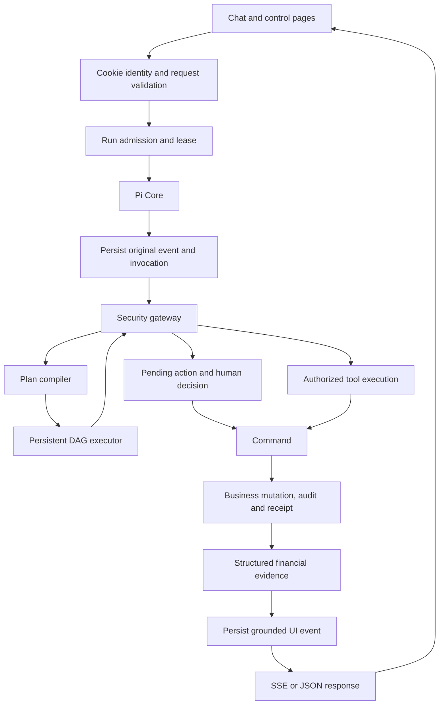
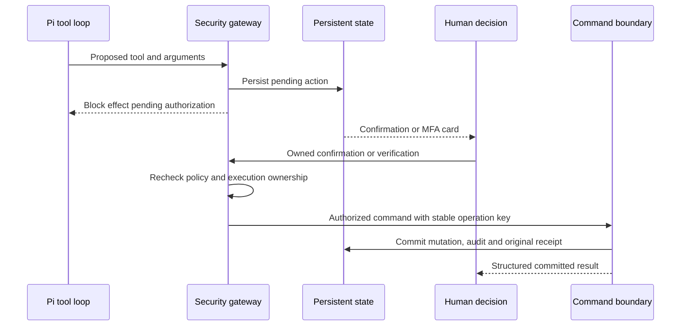

# Banking agent architecture

The application separates model proposals, server authorization and committed banking facts. Pi Core supplies the conversation and tool loop; server code controls capability access, workflow ownership, financial transactions and what the interface may claim. Banking data and verification are simulated.

Setup and commands belong in the [development guide](development.md). This document describes the current runtime and its module boundaries.

## Runtime overview

The command transaction applies to writes. Read tools return owned data without a banking mutation. Workflow submission compiles and persists a graph whose individual tool nodes pass through authorization.

## Module responsibilities

| Boundary | Implementation | Responsibility |
| --- | --- | --- |
| HTTP and pages | [`app/`](../app/), [`app/api/_lib/`](../app/api/_lib/) | Cookie identity, validation, status mapping and transport |
| Frontend consumers | [`components/chat/`](../components/chat/), [`components/runtime/`](../components/runtime/) | Current response validation, streamed cards and execution controls |
| Turn orchestration | [`agent/run-turn.ts`](../agent/run-turn.ts), [`agent/turn-runtime.ts`](../agent/turn-runtime.ts), [`agent/banking-agent.ts`](../agent/banking-agent.ts) | Session restoration, Pi hooks, run lifecycle and presentation |
| Runtime evidence | [`agent/durable/`](../agent/durable/), [`agentRun` repository](../lib/db/repositories/agentRun.ts) | Event ordering, server invocation identities, leases and explicit recovery |
| Capability contracts | [`lib/contracts/`](../lib/contracts/), [`tool catalog`](../lib/contracts/tool-catalog.ts) | Tool names, effects, policy defaults, replay requirements and public DTOs |
| Tool adapters | [`agent/tools/`](../agent/tools/) | Argument schemas and model-free runners bound to the server user |
| Intent and compilation | [`agent/intent-context.ts`](../agent/intent-context.ts), [`agent/tools/plan-compiler.ts`](../agent/tools/plan-compiler.ts) | User-authored references, amount binding, conditions and typed node outputs |
| Workflow execution | [`planner/`](../planner/), [`agent/task-control.ts`](../agent/task-control.ts) | DAG transitions, node claims, leases, pause, resume and cancellation |
| Authorization | [`security/`](../security/), [`agent/confirmation.ts`](../agent/confirmation.ts) | Permission tiers, cumulative risk, confirmation, MFA and incident controls |
| Command transaction | [`agent/command-execution.ts`](../agent/command-execution.ts) | Digest checks, original receipt replay and atomic write completion |
| Banking domain | [`banking-sdk/`](../banking-sdk/) | Owned resources, exact financial arithmetic and simulated banking mutations |
| Persistence and audit | [`lib/db/`](../lib/db/), [`audit/`](../audit/), [`schema`](../prisma/schema.prisma) | Repository access, transaction propagation and durable records |
| Operational workflows | [`manual review`](../agent/manual-review.ts), [`scheduled dispatcher`](../agent/scheduled-dispatcher.ts) | Human handoff, due reminders and freshly authorized payment workflows |

Routes delegate application behavior to the agent and domain layers. Tool schemas do not grant permission. The SDK receives trusted execution context from the server, and repositories resolve the current transaction through the unit of work.

## A conversation turn

1. [`POST /api/chat`](../app/api/chat/route.ts) validates the message and resolves the session from `banking_session`. A body session identifier is only a consistency check; it cannot select another session.
2. The durable turn admits a run under the owned session. A stable `requestId` and matching request digest reuse the admitted run; conflicting input under the same ID is rejected.
3. The agent restores its session state, selects the mock or live provider and constructs a user-bound tool registry. The model can call only the registered capabilities; it receives no shell, SQL or filesystem tool.
4. The journal subscribes before presentation listeners. Each observed Pi event is snapshotted and persisted. A tool-start event and its server-generated invocation identity commit before preflight or effect.
5. The security gateway evaluates the proposed call. It executes eligible work, parks a pending action or rejects the call. A plan submission additionally passes the compiler before graph persistence.
6. Financial narration and cards are grounded in structured execution evidence. Public presentation events commit before delivery through SSE or the JSON response. Session revision checks prevent stale transcript overwrite.

## Authorization and human decisions

The [tool catalog](../lib/contracts/tool-catalog.ts) is the source of names, effects, default tiers and replay requirements. GREEN, YELLOW and RED determine authorization requirements, while `read`, `write` and `workflow` describe effects. These are separate dimensions: a GREEN budget write still needs a transaction and audit, and a YELLOW subscription read still needs confirmation.

Transfers use dynamic amount and cumulative-risk rules. Gated calls persist a `PendingAction`; the model cannot supply its own approval. Confirmation and verification endpoints resolve cookie ownership and recheck current policy before execution. Their continuation uses the same model-free registry runners as workflow nodes.

Security failures, expiry, cancellation and ownership loss remain server decisions. Detailed rules and simulated authentication boundaries are in [security](security.md).

## Workflow compilation and ownership

[`submit_plan`](../agent/tools/planning.ts) uses the plan compiler to validate tool names, dependencies, user-bound objects and amounts, dates, conditions and output references before persistence. [`planner/dag.ts`](../planner/dag.ts) and [`planner/executor.ts`](../planner/executor.ts) own graph semantics; agent adapters supply authorized runners and persisted checkpoints.

The initial executor and resume paths claim nodes under persisted plan ownership. Node claims and subsequent writes are fenced by execution tokens; a stale executor cannot overwrite a replacement executor's result. Lease renewal occurs at node boundaries, and stale takeover remains subject to its expiry rules.

Pause stops later work. Cancellation revokes unexecuted authorizations and preserves committed facts. A gated node parks until its action settles; recovery uses verified stored evidence to settle the node. Limited compensations are explicit workflow operations and do not imply that every banking effect can be reversed.

Manual review blocks new execution claims while retaining an already-started command's identity and evidence. An operator note is not proof of a transfer. See [manual review](manual-review.md) and [known limits](known-risks.md) for continuation and deployment limits.

## Banking command transaction

The command boundary normalizes the tool and arguments into a digest under a stable, server-owned operation key. It checks for a receipt before mutable resource lookup. An existing receipt must match owner, tool, command and response evidence; transfer replay additionally verifies the posted ledger.

For a new write, the common transaction:

1. Obtains the SQLite writer and checks for a competing committed receipt.
2. Rechecks the trusted execution fence inside the transaction.
3. Runs the SDK mutation with the current transaction and audit context.
4. Stores the required audit and complete original response receipt.
5. Completes the linked durable invocation when one exists.

[`lib/db/unit-of-work.ts`](../lib/db/unit-of-work.ts) propagates the Prisma transaction through `AsyncLocalStorage`. [`banking-sdk/execution-context.ts`](../banking-sdk/execution-context.ts) separately carries trusted fence and audit callbacks; these are never model arguments. Nested SDK and repository calls therefore participate in the command transaction.

A required audit failure rolls back the mutation. A matching replay returns the original result. Missing or inconsistent evidence stops for reconciliation; the application does not reconstruct a successful response from unrelated current data. See [money and budget boundaries](money-budget-boundaries.md).

## Runtime evidence and recovery

Runtime durability and banking durability answer different questions:

| Records | What they establish |
| --- | --- |
| `AgentRun`, `AgentRunEvent`, `ToolInvocation` | Which input was admitted, which events occurred and how each invocation progressed |
| `PendingAction`, authorization and workflow records | Whether a human decision and current execution ownership permit work |
| `ExecutionReceipt`, banking records and required audit | Which effect committed and its original result |

The journal keeps original Pi events, execution metadata and grounded UI events in separate channels. Public event APIs expose safe metadata and grounded presentation, not unrestricted raw provider payloads. Provider call IDs are correlation fields; execution identities are generated by the server.

Recovery retains original operation keys. Verified receipts restore committed facts. Retry policy distinguishes reads, proven receipt-backed commands and reconciliation-only operations. Public run recovery retries eligible GREEN reads and restores receipts; it does not silently approve writes, resubmit workflows or regenerate an interrupted model turn.

The project uses Pi Core with its own journal and command transactions. The rationale for retaining one database authority, rather than adding Pi Durable, is in [agent durability](agent-durability.md).

## Financial contracts and time

Booked cash is integer minor units represented by BigInt and Prisma `BigInt` fields. Annual yield ratios and unrounded valuations use Decimal arithmetic and canonical SQLite TEXT storage. Principal, valuation and settlement have distinct meanings. Redemption rounds HALF_UP once to cents and persists the exact quote, rounding policy and original settlement.

Public financial inputs and outputs are decimal strings. `annualYieldRate` is a dimensionless ratio; percentage conversion belongs to presentation. Financial conditions compare exact decimal values; scalar counts retain numeric contracts. Conversion to JavaScript numbers is confined to chart coordinates. Units, bounds and validation are defined in [financial values](financial-values.md).

Business calendar boundaries use UTC+08:00. Authorization expiry, leases and operational scheduling use real time; advancing a demonstration schedule does not renew an authorization.

## Scheduled work and simulator scope

The scheduled dispatcher persists delivered reminders with their audit. A due payment creates or reuses a dispatch workflow and reaches fresh authorization; repeated ticks cannot serve as human approval. The CLI performs one bounded pass, so unattended operation needs a host worker. See [scheduled tasks](scheduled-tasks.md).

`reserve_budget` creates an accounting envelope and does not lock withdrawable cash. Actual merchant procurement, real SMS verification and banking settlement are outside the current simulator. The current schema and API contracts are supported without historical compatibility adapters; [known limits](known-risks.md) records the remaining scope and verification boundaries.
