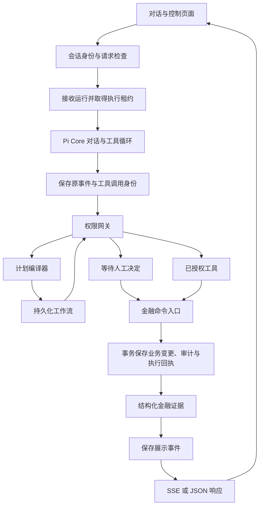

# 架构设计

模型提出操作，服务端决定授权，事务保存金融事实。
Pi Core 负责对话与工具循环。
服务端负责权限、工作流所有权和金融提交。
银行账户、业务接口和认证均使用模拟适配器。

启动命令见[开发指南](development.md)。
字段与术语对应见[术语表](terms.md)。

## 执行路径

SSE 指服务端事件流，JSON 指结构化响应格式。
查询工具返回所属用户的数据。
金融写入通过公共命令事务提交。
工作流的每个工具节点都经过权限网关。

## 模块职责

| 职责 | 代码入口 | 负责内容 |
| --- | --- | --- |
| HTTP 与页面 | [app](../../app/)、[路由辅助模块](../../app/api/_lib/) | 会话身份、请求检查、状态映射和传输。 |
| 前端运行展示 | [chat](../../components/chat/)、[runtime](../../components/runtime/) | 响应检查、流式卡片和执行控制。 |
| 对话轮次编排 | [run-turn.ts](../../agent/run-turn.ts)、[turn-runtime.ts](../../agent/turn-runtime.ts) | 输入生命周期、运行接收和 Pi 运行时。 |
| 授权后续讲 | [authorization-resume.ts](../../agent/authorization-resume.ts) | 将已提交结果写回原调用，再继续对话。 |
| Pi 运行时 | [banking-agent.ts](../../agent/banking-agent.ts) | 创建用户绑定的工具集合，安装执行钩子。 |
| 轮次展示 | [turn-presentation.ts](../../agent/turn-presentation.ts)、[turns](../../agent/turns/) | 展示缓冲、证据绑定、动作卡片和模型请求控制。 |
| 运行持久化 | [durable](../../agent/durable/)、[agentRun 仓储](../../lib/db/repositories/agentRun.ts) | 事件顺序、调用身份、执行租约和恢复。 |
| 工具契约 | [contracts](../../lib/contracts/)、[工具目录](../../lib/contracts/tool-catalog.ts) | 名称、效果、权限、重放规则和公开数据契约。 |
| 工具适配器 | [tools](../../agent/tools/) | 参数 schema 和服务端用户绑定的执行器。 |
| 意图与计划编译 | [intent-context.ts](../../agent/intent-context.ts)、[plan-compiler.ts](../../agent/tools/plan-compiler.ts) | 用户引用、金额绑定、条件和节点输出。 |
| 工作流执行 | [planner](../../planner/)、[workflows](../../agent/workflows/) | 图状态、节点认领、持久化、控制和续跑。 |
| 授权与确认 | [security](../../security/)、[confirmation](../../agent/confirmation/) | 权限、身份、执行有效性和原计划续跑。 |
| 脚本模型 | [mock-responder.ts](../../agent/providers/mock-responder.ts)、[mock](../../agent/providers/mock/) | 按意图分派、解析和结果说明。 |
| 金融命令事务 | [command-execution.ts](../../agent/command-execution.ts) | 参数摘要、回执核验和原子提交。 |
| 银行业务 | [banking-sdk](../../banking-sdk/) | 资源所有权、精确金额运算和模拟业务变更。 |
| 数据与审计 | [lib/db](../../lib/db/)、[audit](../../audit/) | 仓储、事务传递和持久化记录。 |
| 人工与调度 | [manual-review.ts](../../agent/manual-review.ts)、[scheduled-dispatcher.ts](../../agent/scheduled-dispatcher.ts) | 人工接手、提醒和到期付款工作流。 |

路由将业务执行委托给编排层和银行业务层。
工具参数 schema 不授予执行权限。
银行 SDK 接收服务端构造的可信执行上下文。

## 对话轮次

每次对话先取得执行身份，再接收模型输出。
模型只接触当前用户的银行工具。

1. [聊天路由](../../app/api/chat/route.ts)检查请求和 `banking_session` Cookie。
2. 运行入口按所属会话接收请求，并取得执行租约。
3. 运行时恢复会话，解析模型并构造用户绑定的工具集合。
4. 事件记录器先于展示监听器订阅 Pi。
5. 权限网关检查工具提议，再执行、等待授权或拒绝。
6. 展示层按结构化证据生成结果卡片和说明。
7. 会话保存时检查 revision，拒绝过时状态覆盖。

请求正文中的会话标识仅用于一致性检查。
同一 `requestId` 和相同请求摘要复用原运行。
同一标识配不同输入时，服务端拒绝请求。

原 Pi 事件按观察顺序保存。
工具开始事件与服务端调用身份先提交，再检查或执行。
对外展示事件先保存，再通过 SSE 或 JSON 返回。
模型没有 Shell、SQL 或文件系统工具。

## 模型适配

项目使用 Pi 1.1.0 的官方包：

- `@earendil-works/pi-agent-core` 提供对话与工具循环。
- `@earendil-works/pi-ai` 提供模型和服务商适配。

依赖版本见 [package.json](../../package.json)。
`resolveProvider()` 同时返回 `model` 和 `streamFn`。
创建 Agent 时需要同时传入这 2 个值。
`resolveModel()` 仅用于查看模型。

在线模式使用 `builtinModels()` 和原生服务商适配器。
脚本模式为每个运行时创建独立 `fauxProvider()`。
工具参数和结果在 Pi 边界转换为 JSON 数据。
密钥由请求时的服务商鉴权读取，不写入模型快照。

授权结果需要替换原工具调用对应的结果消息。
独立动作按原调用标识与工具名匹配。
工作流动作匹配外层 `submit_plan`。
重用调用标识时，选择最新匹配调用。
配对逻辑见[消息规范化](../../agent/message-normalize.ts)。

## 权限与人工决定

权限与工具效果分别定义，不能互相替代。
定义来源是[工具目录](../../lib/contracts/tool-catalog.ts)。

| 维度 | 值 | 含义 |
| --- | --- | --- |
| 权限 | 绿色、黄色、红色 | 决定自动执行、确认和多因子认证要求。 |
| 效果 | `read`、`write`、`workflow` | 决定查询、金融变更或工作流编排。 |

绿色预算写入仍需要事务和审计。
黄色订阅查询仍需要用户确认。
转账权限还受金额和累计风险规则约束。

需要人工授权时，网关保存 `PendingAction`。
模型不能提供自己的批准结果。
确认与验证码路由先检查 Cookie 所有权。
执行前再检查当前权限和执行所有权。
多因子认证简称 MFA。

权限失效、过期、取消和所有权丢失由服务端判定。
规则与模拟认证边界见[安全设计](security.md)。

## 工作流编译与执行

`submit_plan` 先编译检查，再保存工作流。
编译器检查以下内容：

- 工具名、依赖关系和节点输出引用。
- 所属用户的对象与金额。
- 日期、条件和输出类型。

[dag.ts](../../planner/dag.ts)定义有向无环图语义。
[executor.ts](../../planner/executor.ts)推进节点状态。
编排适配器提供授权执行器和持久化检查点。

执行器按持久化工作流所有权认领节点。
节点认领和后续写入检查执行令牌。
过时执行器不能覆盖接管者的结果。
节点边界更新执行租约。
接管仍需要满足租约到期规则。

| 控制状态 | 执行行为 |
| --- | --- |
| 暂停 | 停止后续节点。 |
| 取消 | 撤销尚未执行的授权，保留已提交事实。 |
| 等待授权 | 节点等待原动作结果。 |
| 等待人工处理 | 禁止新认领，保留已开始命令的身份与证据。 |
| 恢复 | 核验前置节点证据，在原图内继续执行。 |

补偿是显式工作流操作。
补偿不代表全部银行效果都能撤销。
操作员说明也不能证明转账已提交。
人工接手规则见[人工处理](manual-review.md)。

## 金融命令事务

金融写入共用 `executeBankingCommand()`。
命令用服务端执行键绑定工具、用户和参数摘要。
读取可变资源前，命令先查原执行回执。

原回执需要匹配用户、工具、参数和响应证据。
转账还需要核验已经入账的流水。
回执匹配时返回原结果，不再次执行业务变更。

新写入在同一事务内执行以下步骤：

1. 取得 SQLite 写入权，再检查是否存在竞争回执。
2. 检查可信执行上下文中的提交校验。
3. 使用当前事务执行银行业务变更。
4. 保存必需审计和原响应的执行回执。
5. 完成关联的持久化工具调用。

[unit-of-work.ts](../../lib/db/unit-of-work.ts)通过 `AsyncLocalStorage` 传递事务。
[execution-context.ts](../../banking-sdk/execution-context.ts)传递提交校验与审计回调。
嵌套 SDK 与仓储操作参与同一个事务。
可信回调不能由模型参数提供。

必需审计失败时，事务回滚业务变更。
取消先提交时，提交校验拒绝后续业务写入。
业务先提交时，后续控制操作保留真实结果。
提交后返回异常需要按原证据恢复结果。
证据缺失或矛盾时，停止执行并转入人工核对。
执行证据规则见[持久化与恢复](agent-durability.md)。
金额和预算规则见[金融数值与结算](financial-values.md)。

## 持久化证据与恢复

执行记录、授权记录和金融回执分别回答不同问题。

| 记录 | 证明的事实 |
| --- | --- |
| `AgentRun`、`ModelRequest` | 原输入、完整模型请求和完整决策。 |
| `AgentRunEvent`、`ToolInvocation` | 已观察事件，以及 Pi 和工作流工具调用的进度。 |
| `PendingAction`、工作流记录 | 人工决定与当前执行所有权。 |
| `ExecutionReceipt`、业务记录、必需审计 | 已提交效果及原结果。 |

日志区分原 Pi 事件、执行元数据和对外展示事件。
公开接口只提供安全元数据和证据绑定的展示内容。
模型调用标识只用于关联。
服务端生成实际执行身份。

恢复保留原执行键和工具调用身份。
已提交写入从核验后的执行回执恢复。
未完成模型输出按原请求重新生成。
完整决策中的未开始调用经过正常检查与授权。
执行结果未知时，恢复停止自动推进。

恢复还会检查以下条件：

- 执行租约、重试上限和退避时间。
- 原服务商配置、当前工具权限与重放规则。
- 会话 revision 与原人工决定。
- 原工作流和子调用身份。

恢复未完成模型请求时，还要核对原工具声明摘要。
声明变化时，事件记录器拒绝再次提交原请求。
检查入口见 [journal.ts](../../agent/durable/journal.ts)。

独立 HTTP 或调度工作流保存 `workflow_only` 来源。
来源记录和工作流在同一事务内保存。
恢复使用原图，不调用模型重新规划。
工作流恢复允许后续对话 revision 已变化。
认领仍要求任务和会话执行所有权可用。
任务完成时同步来源日志。
子调用完成不会提前结束来源运行。

Pi 模型续跑和独立工作流共用恢复进程。
项目通过 Prisma 保存日志并提交金融命令事务。
执行规则和 Pi Durable 取舍见[持久化与恢复](agent-durability.md)。

## 金融数值与时间

已入账现金按整数分使用 `BigInt` 保存。
收益率和未舍入估值使用 `Decimal` 运算。
SQLite 保存规范化的十进制文本。
本金、估值和结算金额分别定义。

赎回仅在结算时按 `HALF_UP` 舍入到分。
执行回执保留原报价、舍入规则和原结算结果。
公开金融输入与输出使用十进制字符串。
`annualYieldRate` 表示无量纲比例。
展示层负责将比例转换为百分数。

金融条件使用精确十进制比较。
计数仍使用数值类型。
金融值仅在绘制图表坐标时转换为 JavaScript 数值。
单位、边界和检查规则见[金融数值](financial-values.md)。

业务日历使用 UTC+08:00。
授权过期、执行租约和运行调度使用真实时间。
推进演示日期不会续期授权。

## 调度与模拟范围

提醒及其审计持久化保存。
到期付款创建或复用调度工作流，并重新请求授权。
重复调度检查不能代替用户批准。
调度操作见[定时任务](scheduled-tasks.md)。

`reserve_budget` 创建记账用的预算额度。
预算额度不冻结可提现资金。
商户采购、真实短信和银行清算尚未接入。
部署与业务限制见[当前限制](known-risks.md)。
