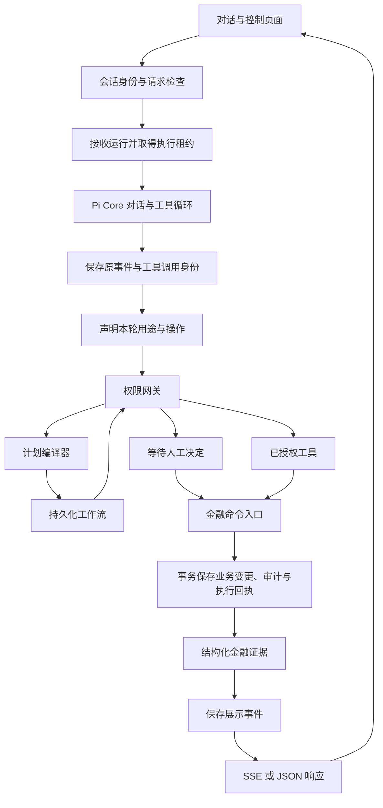

# 架构设计

模型提出操作，服务端决定授权，事务保存金融事实。
Pi Core 负责对话与工具循环。
服务端负责权限、工作流所有权和金融提交。
银行账户、业务接口和认证均使用模拟适配器。

启动命令见[开发指南](development.md)。
字段与术语对应见[术语表](terms.md)。

## 执行路径

SSE 指服务端事件流，JSON 指结构化响应格式。
查询工具返回所属用户的数据。
金融写入通过公共命令事务提交。
工作流的每个工具节点都经过权限网关。

## 模块职责

| 职责 | 代码入口 | 负责内容 |
| --- | --- | --- |
| HTTP 与页面 | [app](../../app/)、[路由辅助模块](../../app/api/_lib/) | 会话身份、请求检查、状态映射和传输。 |
| 前端运行展示 | [chat](../../components/chat/)、[runtime](../../components/runtime/) | 响应检查、流式卡片和执行控制。 |
| 界面语言 | [i18n](../../lib/i18n/) | 中文默认值、双语文案和语言选择保存。 |
| 对话轮次编排 | [run-turn.ts](../../agent/run-turn.ts)、[turn-runtime.ts](../../agent/turn-runtime.ts) | 输入生命周期、运行接收和 Pi 运行时。 |
| 授权后续讲 | [authorization-resume.ts](../../agent/authorization-resume.ts) | 将已提交结果写回原调用，再继续对话。 |
| Pi 运行时 | [banking-agent.ts](../../agent/banking-agent.ts) | 创建用户绑定的工具集合，安装执行钩子。 |
| 轮次展示 | [turn-presentation.ts](../../agent/turn-presentation.ts)、[turns](../../agent/turns/) | 展示缓冲、证据绑定、动作卡片和模型请求控制。 |
| 运行持久化 | [durable](../../agent/durable/)、[agentRun 仓储](../../lib/db/repositories/agentRun.ts) | 事件顺序、调用身份、执行租约和恢复。 |
| 工具契约 | [contracts](../../lib/contracts/)、[工具目录](../../lib/contracts/tool-catalog.ts) | 名称、效果、权限、重放规则和公开数据契约。 |
| 工具适配器 | [tools](../../agent/tools/) | 参数 schema 和服务端用户绑定的执行器。 |
| 轮次声明与计划编译 | [intent-context.ts](../../agent/intent-context.ts)、[turn-intent.ts](../../agent/tools/turn-intent.ts)、[plan-compiler.ts](../../agent/tools/plan-compiler.ts) | 本轮用途、写操作顺序、参数 schema 和节点输出。 |
| 工作流执行 | [planner](../../planner/)、[workflows](../../agent/workflows/) | 图状态、节点认领、持久化、控制和续跑。 |
| 计划失败契约 | [failure.ts](../../planner/failure.ts)、[node-outcome.ts](../../planner/node-outcome.ts) | 结构化拒绝携带、封存判定和节点结果映射。 |
| 授权与确认 | [security](../../security/)、[confirmation](../../agent/confirmation/) | 权限、身份、执行有效性和原计划续跑。 |
| 安全失败与公开文案 | [security-gateway.ts](../../security/security-gateway.ts)、[public-text.ts](../../lib/public-text.ts)、[tool-feedback.ts](../../lib/tool-feedback.ts)、[public-security-event.ts](../../app/api/_lib/public-security-event.ts)、[public-task-text.ts](../../app/schedules/public-task-text.ts) | 结构化拒绝事实、锁定终态和各类对外文案收口。 |
| 脚本模型 | [mock-responder.ts](../../agent/providers/mock-responder.ts)、[mock](../../agent/providers/mock/) | 按意图分派、解析和结果说明。 |
| 金融命令事务 | [command-execution.ts](../../agent/command-execution.ts) | 参数摘要、回执核验和原子提交。 |
| 银行业务 | [banking-sdk](../../banking-sdk/) | 资源所有权、精确金额运算和模拟业务变更。 |
| 数据与审计 | [lib/db](../../lib/db/)、[audit](../../audit/) | 仓储、事务传递和持久化记录。 |
| 人工与调度 | [manual-review.ts](../../agent/manual-review.ts)、[scheduled-dispatcher.ts](../../agent/scheduled-dispatcher.ts) | 人工接手、提醒和到期付款工作流。 |

路由将业务执行委托给编排层和银行业务层。
工具参数 schema 不授予执行权限。
银行 SDK 接收服务端构造的可信执行上下文。

## 数据库运行时

Prisma `7.10.0` 使用 `prisma-client` 生成器。
生成代码位于 `lib/db/generated`。
业务代码从 [prisma.ts](../../lib/db/prisma.ts)导入类型和命名空间。
生成代码不提交到 Git，部署前执行 `pnpm db:generate`。

[prisma.config.ts](../../prisma.config.ts)声明 CLI 数据库地址和种子命令。
CLI 与应用共用 [url.ts](../../lib/db/url.ts)解析地址。
[database.ts](../../lib/db/database.ts)创建带驱动适配器的客户端。
适配器使用 `@prisma/adapter-better-sqlite3`。
原生驱动按精确整数读取 SQLite 的 `BigInt` 金额。
利率和未结算估值仍按十进制文本保存。

每个客户端使用独立的 SQLite 原生连接。
普通查询与事务入口共用连接级队列。
事务提交或回滚前，其他请求的普通查询等待。
这能防止普通写入加入其他请求的事务。
也能防止普通读取看到其他请求未提交的数据。
队列代码见 [serialized-connection.ts](../../lib/db/serialized-connection.ts)。
连接建立时启用外键检查和 WAL。
WAL 是 SQLite 的预写日志模式。
驱动等待、事务等待和事务执行上限均为 `10` 秒。
日期按 Unix 毫秒保存。
事务内的查询通过同一事务句柄执行。
全局客户端不能替代已打开事务的句柄。
该边界避免单连接等待自身持有的事务。

生成、同步表结构和填充模拟数据分别执行。
命令职责见[开发指南](development.md#数据库管理)。

## 业务记录与技术审计

普通用户通过 `/activity` 查看操作记录。
开发者模式通过 `/audit` 查看操作审计。
两类查询都使用服务端配置的用户和共享会话。

业务投影在 [operation-history.ts](../../audit/operation-history.ts)。
仓储先按业务操作名单筛选，再排序和分页。
确认本人交易属于业务操作，查询和开发者维护事件不展示。
`ActivityRecord` 只定义以下字段：

- 事件标识和时间。
- 业务类型。
- 处理状态和身份验证状态。

投影不返回工具参数、结果、原请求和执行控制标识。
普通记录按事件展示，不推测不同事件属于同一笔交易。
未知执行结果保留为待核对，失败事件保留为未完成。

技术审计页面和接口在读取数据前检查开发者模式。
模式 Cookie 用于演示偏好，不提供生产管理员认证。
接口契约见 [activity.ts](../../lib/contracts/activity.ts)。

## 对话轮次

每次对话先取得执行身份，再接收模型输出。
完整归档与发送给模型的视图分别保存。
Pi Coding Agent `1.2.0` 的公开 `compact()` 生成摘要。
摘要提示词和历史序列化由官方 `compact()` 提供。
银行适配层负责阈值、近期完整轮次和压缩检查点。
Pi Core 的请求准备钩子先构造摘要视图。
上下文转换钩子将同一视图发送给模型。
模型请求日志保存该视图，检查点保留完整原始消息。
摘要不授予执行权限，也不替代原话归档。
需要原字或精确金额时，模型使用绿色归档查询工具。
规则见[上下文压缩](context-compaction.md)。
模型只接触当前用户的银行工具。

1. [聊天路由](../../app/api/chat/route.ts)检查请求，加载固定演示身份和共享会话。
2. 运行入口按所属会话接收请求，并取得执行租约。
3. 运行时恢复会话，解析模型并构造用户绑定的工具集合。
4. 事件记录器先于展示监听器订阅 Pi。
5. 模型通过 `describe_turn` 声明本轮用途和操作。
6. 运行时检查声明范围，权限网关检查授权要求。
7. 展示层按结构化证据生成独立工具记录和卡片。
8. 会话保存时检查 revision，拒绝过时状态覆盖。

请求正文中的会话标识仅用于一致性检查。
Web 入口使用固定演示用户和 `demo:${userId}` 会话。
不同浏览器共享已保存对话，身份 Cookie 不参与选择。
同一 `requestId` 和相同请求摘要复用原运行。
同一标识配不同输入时，服务端拒绝请求。

原 Pi 事件按观察顺序保存。
工具开始事件与服务端调用身份先提交，再检查或执行。
对外展示事件先保存，再通过 SSE 或 JSON 返回。
模型没有 Shell、SQL 或文件系统工具。
绿色查询可以先确定操作对象和数量。
需要确认的前置查询使用办理准备声明。
确认读取后，可绑定原请求的完整写入序列。
后续写入仍需单独授权，序列不能再改变。

新用户消息开始一份新的轮次声明。
声明包含用途、操作名称和顺序，可重复声明同一工具。
用途分为交流、建议、查询和办理。
声明只用于约束本轮提议，不能批准金融操作。
已经保存的授权继续使用原操作身份。

交流可使用绿色查询，不能创建需授权的操作。
建议可申请查询授权，不能提交写操作。
办理时，写工具必须属于本轮声明。
声明了多个写操作时，必须先提交完整工作流。
显式工作流标记也要求通过计划入口提交。
同一轮中，声明不能改成另一个用途或操作序列。

在线执行不从用户句子中提取金额或推断用途。
模拟模型的自然语言脚本只保存在 `providers/mock/`。
模型正文完整保留，金融事实由工具记录和回执说明。

## 模型适配

项目使用 Pi `1.2.0` 的官方包：

- `@earendil-works/pi-agent-core` 提供对话与工具循环。
- `@earendil-works/pi-ai` 提供模型和服务商适配。
- `@earendil-works/pi-coding-agent` 提供公开 `compact()`。

银行运行时调用 SDK 的压缩公开函数。
Coding Agent 的 `AgentSession.compact()` 属于上层编码会话。
银行会话继续使用 Prisma，编码工具未加入银行注册表。
SDK 的命令行、终端界面等传递依赖仍会安装。
依赖代价见[上下文压缩](context-compaction.md)。

依赖版本见 [package.json](../../package.json)。
`resolveProvider()` 同时返回 `model` 和 `streamFn`。
创建 Agent 时需要同时传入这 2 个值。
`resolveModel()` 仅用于查看模型。

在线模式只注册当前服务商的原生适配器。
模型目录按项目支持的服务商显式声明。
内置服务商包括 DeepSeek、OpenAI、Anthropic、Google、
Groq、OpenRouter、xAI、Mistral 和 Cerebras。
其他兼容服务商需要显式配置 API 地址。
脚本模式为每个运行时创建独立 `fauxProvider()`。
工具参数和结果在 Pi 边界转换为 JSON 数据。
密钥由请求时的服务商鉴权读取，不写入模型快照。

授权结果需要替换原工具调用对应的结果消息。
独立动作按原调用标识与工具名匹配。
工作流动作匹配外层 `submit_plan`。
调用标识重复时，按原授权、运行和模型请求确定所属调用。
配对逻辑见[授权上下文](../../agent/authorization-context.ts)。

## 权限与人工决定

权限与工具效果分别定义，不能互相替代。
定义来源是[工具目录](../../lib/contracts/tool-catalog.ts)。

| 维度 | 值 | 含义 |
| --- | --- | --- |
| 权限 | 绿色、黄色、红色 | 决定自动执行、确认和多因子认证要求。 |
| 效果 | `read`、`write`、`workflow` | 决定查询、金融变更或工作流编排。 |

绿色预算写入仍需要事务和审计。
黄色订阅查询仍需要用户确认。
转账权限还受金额和累计风险规则约束。

需要人工授权时，网关保存 `PendingAction`。
模型不能提供自己的批准结果。
确认与验证码路由先检查资源是否属于固定演示用户及共享会话。
执行前再检查当前权限和执行所有权。
多因子认证简称 MFA。

拒绝事实用 `SecurityFailure` 的 `code`、`reason` 和次数表示。
验证码失败达上限后，操作进入 `locked` 终态。
`locked` 不再作为待决定项，也不允许恢复或重试。
网关的 `blockReason` 是内部载荷，不进入对外文案。
公开文案由 [public-text.ts](../../lib/public-text.ts) 和 [tool-feedback.ts](../../lib/tool-feedback.ts) 收口。
锁定与失败规则见[安全设计](security.md#多因子认证)。

权限失效、过期、取消和所有权丢失由服务端判定。
规则与模拟认证边界见[安全设计](security.md)。

## 工作流编译与执行

`submit_plan` 先编译检查，再保存工作流。
编译器检查以下内容：

- 工具名、依赖关系和节点输出引用。
- 声明中的写操作数量和顺序。
- 工具参数类型、所属用户的资源和金额范围。
- 显式日期、条件路径和输出类型。

模型提交明确的结构化参数和依赖关系。
编译器不根据原句补写金额、对象或前置依赖。
卡片、产品和持仓使用实际资源标识。
条件使用明确的查询月份、比较符和阈值。

[dag.ts](../../planner/dag.ts)定义有向无环图语义。
[executor.ts](../../planner/executor.ts)推进节点状态。
编排适配器提供授权执行器和持久化检查点。

执行器按持久化工作流所有权认领节点。
节点认领和后续写入检查执行令牌。
过时执行器不能覆盖接管者的结果。
节点边界更新执行租约。
接管仍需要满足租约到期规则。

| 控制状态 | 执行行为 |
| --- | --- |
| 暂停 | 停止后续节点。 |
| 取消 | 撤销尚未执行的授权，保留已提交事实。 |
| 等待授权 | 节点等待原动作结果。 |
| 等待人工处理 | 禁止新认领，保留已开始命令的身份与证据。 |
| 恢复 | 核验前置节点证据，在原图内继续执行。 |

补偿是显式工作流操作。
补偿不代表全部银行效果都能撤销。
操作员说明也不能证明转账已提交。
人工接手规则见[人工核对](manual-review.md)。
后台核对演示只在开发者模式提供。
卡片增删使用独立页面流程，规则见[卡片管理](card-management.md)。

## 安全拒绝的传播

拒绝事实按网关、工具结果、计划节点、运行时结算、HTTP 出口、页面呈现的顺序传递。
每一步只传结构化字段，原始网关载荷不进入可渲染文本。
网关的拒绝事实与锁定规则见[安全设计](security.md#多因子认证)。

1. 网关判定拒绝并返回 `SecurityFailure` 的 `code`、`reason` 和次数。
2. [gated-execution.ts](../../agent/confirmation/gated-execution.ts)的 `blockedOutcome` 只取 `parseBlockReason` 解析出的 `failure` 作为对外拒绝。
3. [outcomes.ts](../../agent/confirmation/outcomes.ts)的 `publicRefusalMessage` 按三级顺序取文案：有 `failure` 时用 `securityNotice`，只有 `code` 时用 `publicToolError`，其余用 `safePublicText`。
4. 计划节点在进程内快照里携带 `PlanFailure` 与 `actionStatus`，并据此拒绝再次驱动该节点。
5. 运行时把动作终态结算到工具调用，HTTP 出口按错误码返回状态码或领域结果。
6. 页面与微信只渲染 [public-text.ts](../../lib/public-text.ts) 生成的公开文案。

计划层的失败契约在 [failure.ts](../../planner/failure.ts)。
`PlanFailure` 含 `code`、可选 `reason`、`actionId` 和次数。
`toPlanFailure` 只复制已存在的类型化字段，`AppError` 只保留 `code`。
`isLockedRefusal` 依据 `reason` 或 `code` 判定，不读取消息文本。

节点结果用可选字段 `failure` 与 `actionStatus` 携带这两个事实。
[node-outcome.ts](../../planner/node-outcome.ts)的 `settleToolNode` 原样携带这两个字段。
同一次映射用 `publicFailureText` 投影 `summary` 和 `error`。
内部诊断因此不会写入节点字段，业务正文按原样保留。
缺少这两个字段的节点不视为封存。
这两个字段不落库，节点行只存 `status`、`output`、`error` 与起止时间。
写入映射见 [task-fencing.ts](../../agent/task-fencing.ts) 的 `toNodeUpdate`，读回映射见 [persistence.ts](../../agent/workflows/persistence.ts) 的 `toTaskPlan`。
封存证据随进程结束失效，进程重启后的驱动由执行回执与幂等约束把关。

`SealReason` 取 `locked_refusal` 或 `action_not_open`。
`sealReason` 先判锁定拒绝，再判 `actionStatus` 已不属于 `pending` 或 `awaiting_mfa`。
[executor.ts](../../planner/executor.ts)的 `runToolNode` 在认领节点之前调用 `mayDriveNode`。
被封存的节点走 `sealNode`，不调用工具，也不新建待决定动作。
`sealNode` 只把节点收敛为 `failed`，已记录的拒绝事实保持不变。
工具抛出的错误同样记录为 `failure` 和经投影的 `error`。

`mayResetNode` 只按封存状态拒绝重置。
[executor.ts](../../planner/executor.ts)的重试扫描与 [lifecycle.ts](../../planner/lifecycle.ts)的 `retryPlan` 都跳过封存节点。
`resumePlan` 在 `mayDriveNode` 为假时原样返回计划，不记录过时决定。
[parked-actions.ts](../../agent/workflows/parked-actions.ts)的 `assertParkedActionsNotTerminal` 在认领之前只读检查停等动作。
该检查在动作已终态时抛出结构化 `AppError`。
`locked` 返回 `MFA_LOCKED`，其他终态返回 `CONFLICT`。
检查的诊断字段只写入 `detail`。

[agentRun.ts](../../lib/db/repositories/agentRun.ts)的 `settleInvocationFromAction` 把 `locked` 结算为 `ToolInvocation.status='failed'` 和 `errorCode='MFA_LOCKED'`。
`locked` 不结算为 `needs_reconciliation`，因为锁定是已知结果而非未知提交。
`SETTLED_PENDING_ACTION_STATUSES` 含 `locked`，`RUN_BLOCKING_PENDING_ACTION_STATUSES` 不含 `locked`。
先结算再判定运行终态，因此只含锁定动作的运行也结束为 `failed`。

[app/api/_lib/http.ts](../../app/api/_lib/http.ts)的 `STATUS_BY_CODE` 统一映射错误码：

| 错误码 | HTTP 状态 |
| --- | --- |
| `MFA_LOCKED`、`CIRCUIT_OPEN` | `423` |
| `SECURITY_DENIED`、`MFA_FAILED` | `403` |
| `CONFLICT` | `409` |
| `VALIDATION` | `400` |
| `NOT_FOUND` | `404` |
| `INSUFFICIENT_FUNDS`、`LIMIT_EXCEEDED` | `422` |
| `TOOL_FAILED` | `502` |
| `INTERNAL` 与未知异常 | `500` |

非 `AppError` 的异常只返回 `INTERNAL` 和通用消息。
响应信封为 `{ ok: true, data }` 或 `{ ok: false, error }`。

已锁定动作上的决定请求返回领域结果，不返回错误信封。
[locked-action.ts](../../app/api/_lib/locked-action.ts)的 `lockedActionRefusal` 返回 `200` 且 `data.ok=false`。
该拒绝携带 `code='CIRCUIT_OPEN'` 与 `failure.reason='mfa_session_locked'`。
拒绝文案固定，不含验证码，也不推断剩余次数。
`/api/actions` 的决定状态只含 `pending`、`awaiting_mfa` 和 `needs_reconciliation`。

安全事件在出口处净化。
[public-security-event.ts](../../app/api/_lib/public-security-event.ts)的 `publicSecurityEvent` 保留标识、时间、会话、类型与严重级别。
空消息或内部诊断消息落为空字符串，键本身保留。
`detail` 仅在为纯 JSON 且所有字符串叶子都非内部诊断时保留，否则整键省略。
事件本身不会被过滤或丢弃。
`/api/security` 的事件与状态内近期事件都经过该投影。

任务读取接口附加动作的当前状态。
[task-pending-actions.ts](../../app/api/_lib/task-pending-actions.ts)为带 `pendingActionId` 的节点补充只读字段 `pendingActionStatus`。
该模块不写状态，动作行缺失时不补充字段。

对话流、确认卡片与微信桥都调用 `securityNotice`，不自行拼接拒绝文本。
[public-task-text.ts](../../app/schedules/public-task-text.ts)的 `publicScheduleText` 单独门控 `/schedules` 的服务端文本。
该函数只用 `isInternalDiagnostic` 判定，不用 `safePublicText`，因此业务正文按原样显示。

## 金融命令事务

金融写入共用 `executeBankingCommand()`。
命令用服务端执行键绑定工具、用户和参数摘要。
读取可变资源前，命令先查原执行回执。

原回执需要匹配用户、工具、参数和响应证据。
转账还需要核验已经入账的流水。
回执匹配时返回原结果，不再次执行业务变更。

新写入在同一事务内执行以下步骤：

1. 取得 SQLite 写入权，再检查是否存在竞争回执。
2. 检查可信执行上下文中的提交校验。
3. 使用当前事务执行银行业务变更。
4. 保存必需审计和原响应的执行回执。
5. 完成关联的持久化工具调用。

[unit-of-work.ts](../../lib/db/unit-of-work.ts)通过 `AsyncLocalStorage` 传递事务。
[execution-context.ts](../../banking-sdk/execution-context.ts)传递提交校验与审计回调。
嵌套 SDK 与仓储操作参与同一个事务。
可信回调不能由模型参数提供。

必需审计失败时，事务回滚业务变更。
取消先提交时，提交校验拒绝后续业务写入。
业务先提交时，后续控制操作保留真实结果。
提交后返回异常需要按原证据恢复结果。
证据缺失或矛盾时，停止执行并转入人工核对。
执行证据规则见[持久化与恢复](agent-durability.md)。
金额和预算规则见[金融数值与结算](financial-values.md)。
卡片消费扣减结算活期账户现金，并写入消费流水。
绑定、余额展示与数据升级规则见[卡片管理](card-management.md)。

## 持久化证据与恢复

执行记录、授权记录和金融回执分别回答不同问题。

| 记录 | 证明的事实 |
| --- | --- |
| `AgentRun`、`ModelRequest` | 原输入、完整模型请求和完整决策。 |
| `AgentRunEvent`、`ToolInvocation` | 已观察事件，以及 Pi 和工作流工具调用的进度。 |
| `PendingAction`、工作流记录 | 人工决定与当前执行所有权。 |
| `ExecutionReceipt`、业务记录、必需审计 | 已提交效果及原结果。 |

日志区分原 Pi 事件、执行元数据和对外展示事件。
公开接口只提供安全元数据和证据绑定的展示内容。
模型调用标识只用于关联。
服务端生成实际执行身份。

恢复保留原执行键和工具调用身份。
已提交写入从核验后的执行回执恢复。
未完成模型输出按原请求重新生成。
完整决策中的未开始调用经过正常检查与授权。
执行结果未知时，恢复停止自动推进。

恢复还会检查以下条件：

- 执行租约、重试上限和退避时间。
- 原服务商配置、当前工具权限与重放规则。
- 会话 revision 与原人工决定。
- 原工作流和子调用身份。

恢复未完成模型请求时，还要核对原工具声明摘要。
声明变化时，事件记录器拒绝再次提交原请求。
检查入口见 [journal.ts](../../agent/durable/journal.ts)。

独立 HTTP 或调度工作流保存 `workflow_only` 来源。
来源记录和工作流在同一事务内保存。
恢复使用原图，不调用模型重新规划。
工作流恢复允许后续对话 revision 已变化。
认领仍要求任务和会话执行所有权可用。
任务完成时同步来源日志。
子调用完成不会提前结束来源运行。

Pi 模型续跑和独立工作流共用恢复进程。
项目通过 Prisma 保存日志并提交金融命令事务。
执行规则和 Pi Durable 取舍见[持久化与恢复](agent-durability.md)。

## 投资申赎

申购和赎回由[投资业务](../../banking-sdk/investment.ts)在同一事务中处理。
持仓按净值与份额记账，口径见[理财产品](investments.md)。
申购先校验产品起投金额和账户余额，再扣款并登记持仓。
本次所得份额是 `FLOOR(金额 ÷ 最新净值, 6 位小数)`。
对同一产品的再次申购并入原持仓，不新建持仓。
并入时，成本与份额同时增加，并追加购买记录。
追加申购金额不计入收益。
持仓视图返回份额、最新净值、市值、收益与购买记录。

赎回必须显式给出 `mode`：`SHARES`、`AMOUNT` 或 `ALL`。
到账金额是 `HALF_UP(份额 × 成交净值, 人民币分)`，只取整一次。
`ALL` 把持仓置为已赎回，另两种保持持有并扣减份额与剩余成本。
剩余成本按份额比例扣减且守恒。
确认快照与当前净值或份额不一致时抛 `CONFLICT`，要求重新确认。
展示口径见[理财产品](investments.md)。
估值与结算规则见[金融数值](financial-values.md)。
报价确认和重放规则见[银行工具契约](tool-contracts.md)。

## 金融数值与时间

已入账现金按整数分使用 `BigInt` 保存。
收益率和未舍入估值使用 `Decimal` 运算。
SQLite 保存规范化的十进制文本。
本金、估值和结算金额分别定义。

赎回仅在结算时按 `HALF_UP` 舍入到分。
执行回执保留原报价、舍入规则和原结算结果。
公开金融输入与输出使用十进制字符串。
`annualYieldRate` 表示无量纲比例。
展示层负责将比例转换为百分数。

金融条件使用精确十进制比较。
计数仍使用数值类型。
金融值仅在绘制图表坐标时转换为 JavaScript 数值。
单位、边界和检查规则见[金融数值](financial-values.md)。

业务日历使用 UTC+08:00。
授权过期、执行租约和运行调度使用真实时间。
推进演示日期不会续期授权。

## 调度与模拟范围

提醒及其审计持久化保存。
到期付款创建或复用调度工作流，并重新请求授权。
重复调度检查不能代替用户批准。
调度操作见[定时任务](scheduled-tasks.md)。

`reserve_budget` 创建记账用的预算额度。
预算额度不冻结可提现资金。
商户采购、真实短信和银行清算尚未接入。
部署与业务限制见[当前限制](known-risks.md)。
