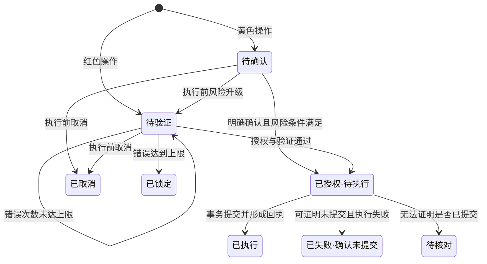

# 万象柜坊 EvoX Omni 安全自评报告

**报告日期**：2026 年 10 月 27 日。

## 1. 评估结论与适用范围

当前版本以服务端权限、原操作授权、事务提交和执行回执控制银行业务。权限、认证、熔断、审计及任务控制的选定回归场景，已在隔离模拟环境通过。

本报告面向受控本地演示。结论不包含生产部署认证、独立渗透测试或真实资金安全认证。在线模型的表达与意图稳定性，也不能由 mock 测试替代。

### 1.1 演示条件

| 项目 | 当前设置 | 评估口径 |
| --- | --- | --- |
| 用户身份 | Web 免登录，使用固定演示用户与共享会话 | 便于连续展示及跨终端查询同一份业务记录 |
| 银行业务 | 本地模拟账户、流水、持仓、卡片与订阅 | 不接入真实资金或支付网络 |
| 强验证 | 固定演示验证码，不发送真实短信 | 验证挑战与状态流程，不代表真实多因子认证 |
| 人工角色 | 开发者模式模拟后台核对人员 | 无独立员工登录与岗位分权 |
| 时间 | 业务使用固定演示日期，安全过期使用真实时间 | 统计结果与认证计时分别解释 |
| 接入渠道 | Web 与微信通道调用银行服务 | 业务权限由银行服务执行，渠道不授予额外权限 |

固定演示用户属于演示范围设置。服务端仍检查资源归属、参数、原操作与执行权限。公开服务前，需要替换为真实身份与会话体系。

### 1.2 评估对象

评估覆盖消息入口、智能体编排、工具目录、安全网关、模拟银行工具库、任务恢复和本地持久化。重点检查以下资产：

- **业务资产**：账户余额、流水、理财份额、卡片状态及消费额度。
- **授权资产**：待确认操作、认证挑战、命令摘要及执行资格。
- **运行资产**：任务图、节点结果、执行租约和恢复检查点。
- **证据与隐私资产**：执行回执、业务审计、安全事件、对话及服务凭据。

## 2. 威胁模型与信任边界

模型输出、用户文本和外部通道消息都作为待检查输入。模型可以建议操作，但不能自行授予权限或直接修改银行数据。

| 边界 | 主要威胁 | 当前控制 |
| --- | --- | --- |
| 消息进入智能体 | 模糊意图、历史指令误续办、提示注入 | 用途声明、上下文区分、澄清与工具效果检查 |
| 智能体进入安全网关 | 参数越界、越权对象、伪造低风险 | 服务端工具策略、参数与归属校验、动态风险计算 |
| 确认进入业务提交 | 替换金额、重放验证码、重复点击 | 原操作摘要绑定、挑战状态及条件更新认领 |
| 业务进入数据库 | 并发超支、重复记账、审计缺失 | 事务、稳定执行键、执行回执与必需审计 |
| 运行进入恢复 | 旧执行者继续写入、未知结果被重试 | 所有权检查、版本与租约约束、待核对分支 |
| 服务结果进入界面 | 虚假成功、跨操作混淆、内部标记泄露 | 结构化结果、原操作事实核验、公开错误转换 |

本地数据库管理员、操作系统管理员和模型服务供应方不属于应用可完全约束的角色。文件访问、供应方留存和主机安全仍需要部署环境控制。

## 3. 权限分级实现说明

权限策略保存在服务端工具目录，执行时再次校验。模型提供的风险颜色、用户自称的身份或历史确认文字，都不能降低权限。

### 3.1 分级与执行策略

下表描述 Agent 工具策略。业务页面的直接办理接口独立校验，不能通过绕过对话页面取得执行权限。

| 级别 | 执行条件 | 当前操作示例 |
| --- | --- | --- |
| 绿色 | 参数与资源归属检查通过后自动执行 | 余额、流水、账单分析、异常检测、卡片及理财查询 |
| 黄色 | 展示原操作详情并取得明确确认 | 小额转账、订阅查询与取消、分类消费限额、续费提醒、定时意图创建 |
| 红色 | 展示原操作详情，取得授权并通过模拟验证码验证 | 大额或累计超限转账、理财申购与赎回、锁卡与解锁、挂失与补办、虚拟卡申请与消费 |

展示操作详情时，服务端提供实际资源名称、金额或份额、风险等级和执行状态。确认操作绑定这份原始记录，不由模型重新生成一份替代命令。

订阅查询在 Agent 中采用黄色策略；订阅页面读取已登记记录属于页面查询。两种入口的交互策略分别处理，取消订阅等写入仍受服务端约束。

### 3.2 转账的动态分级

转账始终要求确认。单笔金额或预计当日累计超过 **1000.00 元**时升级红色；等于 1000.00 元时保持黄色。

预计累计包括当日已入账转出、尚未入账的已授权在途转出和本次金额。同一执行已经入账后，不再重复计入在途金额。

例如，同时准备两笔 600.00 元转账，不能都依据最初零累计额执行。第一笔取得执行资格后，第二笔应计入该在途或已入账金额，预计累计达到 1200.00 元，因此要求验证。

风险在确认和实际执行时复核。原黄色操作若已超出当前阈值，返回待验证状态，不先扣款再补认证。

### 3.3 特殊策略与能力范围

- **预算为绿色写入**：只新增记账预算，不冻结或转移资金，仍记录写入审计。
- **提交 DAG 为绿色编排**：只编译任务图，不授权节点中的银行业务。
- **虚拟卡申请为红色**：较赛题黄色示例更严格，要求模拟强验证。
- **全新实体卡创建和卡片删除由页面办理**：采用页面确认与红色验证，Agent 没有直接执行入口。
- **分类消费限额与授信分离**：Agent 不修改信用卡总授信，不自行批准提额或降额。

## 4. 授权、验证与操作状态

### 4.1 原操作绑定

待确认操作保存所属用户、具体资源、规范化参数、命令摘要和策略事实。认证挑战同时绑定该操作和摘要。更换收款人、金额、持仓或其他执行参数，需要重新发起授权。

Web 确认按钮和微信显式操作命令，都提交服务端原操作标识。聊天中普通的“确认”不能直接替代原操作验证。

### 4.2 验证挑战

挑战有效期为 **5 分钟**，单个挑战最多允许 **3 次**错误。有效挑战的重复获取不会重置错误次数。

| 验证情况 | 状态与业务结果 |
| --- | --- |
| 第 1、2 次错误 | 继续等待验证，不提交原业务 |
| 第 3 次错误 | 挑战与原操作锁定，并触发所有者熔断 |
| 挑战过期 | 旧验证码提交不能授权业务，需获取有效挑战 |
| 命令摘要变化 | 原挑战失效，不能给修改后的业务授权 |
| 重复提交正确验证码 | 依据原操作状态与回执处理，不重复执行 |
| 原操作已取消或锁定 | 拒绝旧确认与旧验证入口 |

演示验证码固定为 `123456`，仅用于体验认证流程。生产多因子认证需要独立认证因素、可信交付渠道与身份绑定。

### 4.3 主要状态转换

以下展示授权与执行的主要路径。状态以持久化记录为准，界面刷新不会重置操作。

已入账成功的业务保持已执行，不因取消计划而改写为取消。待核对表示结果未知，不能解释成失败，也不能据此宣称资金未变化。

## 5. 资金、并发与恢复安全

### 5.1 原子性与幂等

资金变更、对应流水、执行回执和必需写入审计在同一事务内提交。必需审计写入失败时，业务事务回滚。

执行身份区分用户、原操作及计划节点。幂等核验还检查工具和参数摘要，不能只凭相同金额判断为同一业务。不同计划中的相同转账请求，仍属于不同操作。

| 故障或竞争 | 保护方式 | 用户可见含义 |
| --- | --- | --- |
| 重复确认、并发恢复 | 数据库条件更新认领执行权 | 不重复取得同一业务的执行资格 |
| 扣款与流水中途失败 | 同事务回滚 | 不保留只有扣款、没有流水的半笔结果 |
| 已提交但回复丢失 | 核验稳定身份与原回执 | 重放原结果，不再次扣款或发卡 |
| 取消与执行并发 | 执行检查点与真实提交事实判定 | 取消阻止后继步骤，已提交业务保留 |
| 旧执行者恢复运行 | 会话版本、租约与提交所有权检查 | 失去执行权后不能继续提交新的金融变更 |
| 回执缺失或不匹配 | 停止自动写入重试 | 转人工核对，不猜测成功或失败 |

SQLite 的事务保证适用于当前本地部署，不能据此推导多实例的整体安全性。跨进程争用、连接配置和超时仍需部署级验证。

### 5.2 金融数值与业务快照

金额按整数分计算；净值、份额与未舍入估值按精确十进制计算。舍入只在指定份额和结算边界发生。

理财赎回重新检查持仓、份额和净值。授权快照失效时要求重新确认，不把超量请求截断为可用份额。卡片消费共同检查状态、关联账户、余额和剩余限额，不因补卡重置当月已用额度。

### 5.3 任务控制与人工接管

暂停在安全检查点停止后继节点，继续沿原图恢复。取消撤销尚未执行的授权，但不能抹去已发生的资金和资源变更。

显式回退只处理可核验归属、仍可撤销的预算与未来定时记录。已使用预算、已执行定时任务及未知结果不自动回退。

人工接管先停止自动推进，再登记核对原因与处理决定。人工角色可停止、恢复或在允许条件下重试；仍不能代替用户验证、凭说明认定交易成功，或直接改写账本。

## 6. 幻觉、注入与执行隔离

### 6.1 金融事实防护

执行状态由原操作、银行返回和执行回执确定，模型文字不作为成功凭证。结果分别绑定账户和操作身份，避免把一笔成功结果套用到另一笔失败或待核对操作。

界面确认面板只来自真实待决策记录。若模型没有创建操作，系统不能仅凭“请在上方面板确认”显示一个虚构授权入口。

对未知结果使用待核对状态，不承诺资金未变。公开错误从结构化原因转换，内部协议片段、堆栈和诊断标记不直接进入聊天正文。

自然语言的解释仍受模型能力影响，因此事实防护与用户确认共同使用。该机制不代表能够识别任意语言、任意表达中的所有错误叙述。

### 6.2 注入防御

提示词约束与特征检测用于解释、提醒和记录风险。真正的执行权限由以下控制承担：

1. **工具入口**：只允许已注册业务工具，并校验结构化参数。
2. **资源与授权**：检查归属、规范化对象、风险等级、原操作及验证状态。
3. **提交检查**：核验执行身份、所有权、业务快照和事务约束。

“忽略安全规则”“我是管理员”等文本不能改变服务端策略。历史摘要、工具返回和被引用的对话也不能产生新的授权。

### 6.3 沙箱与隔离范围

模型工具集中没有任意 Shell、SQL、文件编辑或代码执行接口。系统通过受控工具调用限制执行范围，模型不直接连接数据库。

当前版本没有容器或虚拟机级的生成代码沙箱。针对赛题的执行隔离要求，系统只开放注册业务工具，不执行模型生成的代码。若后续加入生成代码执行能力，需新增独立受限环境与监控。现有工具隔离不能作为完整代码沙箱的证明。

## 7. 异常熔断与审计追踪

### 7.1 熔断触发与限制

熔断状态按所有者保存到数据库。重启或切换会话不会清除同一所有者的锁定，恢复后仍执行受保护操作的拦截。

| 信号 | 当前处理 |
| --- | --- |
| 连续认证失败达到 3 次 | 锁定原操作并触发所有者熔断 |
| 已登记的银行命令提交前业务失败，在 5 分钟内达到 5 次 | 记录风险信号并按规则触发熔断 |
| 检测到可疑提示指令 | 记录风险信号与安全事件，文本特征本身不直接触发锁定 |

风险信号按事件身份去重，避免同一失败重复累计。将可疑文本作为记录而非直接锁定条件，也避免正常引用攻击示例造成误锁。

### 7.2 熔断恢复

运行时解锁要求正确模拟验证码，或已满足 **60 秒**真实时间冷却条件。冷却到期只满足解锁条件，仍需显式请求，不会自动解锁。

解锁状态更新与安全审计在同一事务中提交。审计失败保留原锁定；并发旧请求不能清除后来形成的新锁定。解锁后，已经锁定的原操作仍保持终态，需要重新发起业务并重新授权。

开发者维护入口用于演示角色。生产维护权限需要独立员工身份与权限分离，不能由界面模式开关替代。

### 7.3 审计内容与保护

关键决策按请求、原操作、任务节点与执行身份关联。决策依据记录可检查的输入与策略结果，不要求公开模型内部思维过程。

| 记录类型 | 主要内容 | 用途 |
| --- | --- | --- |
| 运行与调用记录 | 用户原输入、工具调用、事件顺序、检查点 | 追踪规划与执行过程 |
| 业务审计 | 原参数、授权、风险事实、执行身份与真实结果 | 核查副作用及授权依据 |
| 安全事件 | 认证失败、可疑指令、锁定、解锁与拒绝 | 分析安全决策与异常行为 |
| 执行回执 | 已提交业务的原结果及关联身份 | 支持事实核验和结果重放 |

写入审计按操作效果判定，绿色写入同样覆盖。纯查询通过运行记录追踪，不要求每次查询都新增写操作审计。

当前记录位于本地存储，没有独立防篡改存储或审计签名。主机管理员权限、备份和文件访问仍需演示环境管理。

### 7.4 数据与凭据保护

普通工具结果和页面默认使用脱敏号码。完整新发或补办卡号由专用接口核验后展示，不由模型编造或复述。演示使用的姓名、卡号、手机号均为虚构测试资料。

日志与模型事件采用字段及内容规则脱敏，但不能保证识别任意自由文本中的秘密。在线模型可能接收用户原文及必要工具结果。演示只使用虚构数据，不输入真实密码、生产凭据或真实客户资料。

## 8. 验证方法与结果

### 8.1 判定方法

验证同时核对接口或可见结果、持久化状态、业务变更和审计记录。拒绝、锁定和失败场景检查是否出现未授权副作用；重复请求检查是否产生第二次扣款、流水或发卡。

并发场景使用受控执行顺序复现竞争窗口，不只依赖重复运行碰撞。恢复场景区分已提交、可证明未提交与结果未知，分别检查重放、重试和人工核对。

### 8.2 已有回归结果

以下为当前产品版本已完成的选定回归，使用 **mock 模型与隔离 SQLite 测试库**。

| 验证范围 | 结果 | 验证要点 |
| --- | --- | --- |
| 权限、累计风险、认证、注入、熔断与写入审计 | 146 项通过 | 金额边界、风险升级、挑战失效、熔断持久化及审计失败回滚 |
| DAG、上下文、任务控制、受限回退与人工核对 | 138 项通过 | 依赖与声明顺序、暂停恢复、重复控制、回退范围及接管后的授权约束 |

测试通过表明所列输入和竞争条件符合预期，不代表所有输入或所有部署方式均已覆盖。上述数量不是全量测试总数，也不是渗透测试或真实银行验收结果。

### 8.3 仍需独立验证的范围

- 在线模型的模糊表达、跨轮省略、隐含意图和拒绝稳定性。
- 微信真机的完整业务流程、重复消息与网络重连。
- 多进程部署、数据库争用、租约接管与进程中断恢复。
- 真实身份、短信或生物认证、银行接口及外部对账。
- 主机、网络、依赖供应链和审计存储的独立安全测试。

## 9. 已知风险清单

本报告重点列出以下 4 项风险。

| 编号 | 重点风险 | 可能影响 | 控制措施与后续工作 |
| --- | --- | --- | --- |
| R01 | 模型意图理解偏差 | 模糊表达或多轮对话可能被误解，或未发起预期业务 | 保留澄清、用途检查、原操作确认与事实核验；补充真实模型复杂场景验收 |
| R02 | 数据与隐私保护 | 模型外发内容可能遗漏脱敏；本地数据库与审计尚无静态加密和防篡改保护 | 演示仅用虚构数据，限制文件访问并备份；生产接入前补齐外发控制、加密和审计保护 |
| R03 | 中断后的结果不确定 | 进程或网络中断后，暂时无法确认业务是否已提交 | 优先核验原执行回执；未知结果转人工核对，不盲目重试，保留已入账事实 |
| R04 | 多进程并发验证不足 | 数据库争用、长时间阻塞或租约接管可能影响执行与恢复 | 使用事务、条件更新和执行所有权检查；部署扩展前补充并发与故障恢复测试 |

## 10. 生产接入前置条件

从本地演示扩展为公开服务，需要先建立以下基础：

1. **身份与角色**：真实用户登录、会话隔离、员工分权及维护权限审批。
2. **认证与渠道**：独立认证因素、真实验证服务和可信渠道绑定。
3. **交易与对账**：外部受理状态、幂等键、对账回执及可追踪补偿。
4. **部署与数据**：加密、访问控制、审计保护、备份恢复及运行监测。
5. **独立验证**：真实模型与真机验收、并发故障测试及安全评估。

当前提交以虚构业务数据展示安全流程，不连接真实资金。

## 11. 配套资料

- [技术文档](技术文档.md)：系统架构、核心算法与执行恢复机制。
- [部署与使用说明](部署与使用说明.md)：环境配置、测试资料与业务演示步骤。
