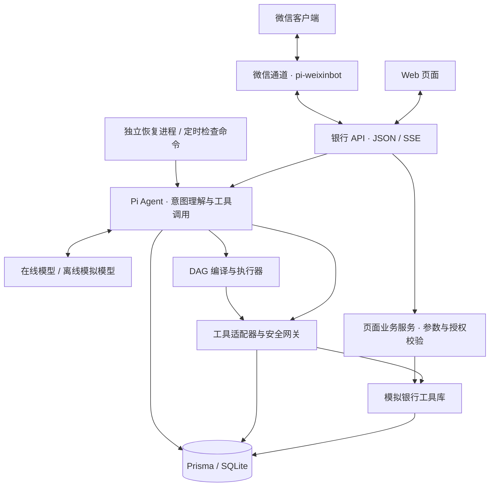
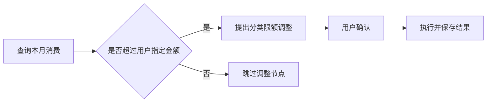

# 万象柜坊 EvoX Omni 技术文档

一坊通万象，一语办万事。

**版本基线**：`0ecb6a01`；**编制日期**：2026 年 10 月 27 日。

## 1. 系统定位

万象柜坊是通过自然语言办理模拟银行业务的智能体。系统支持转账、账单分析、理财、卡片和订阅管理，也支持跨场景工作流。

模型负责理解请求和提出执行步骤。服务端代码负责权限判定、资金计算与业务提交。Web 与微信通道复用银行 API，业务数据保存在同一数据库。

当前版本用于受控演示。银行通道、账户和验证码均为模拟服务，尚未接入真实银行核心系统。

### 1.1 竞赛场景覆盖

前三类核心场景均已提供可执行的主要业务流程。赛题表中的典型能力按实际范围展示。

| 场景方向 | 当前能力 | 范围说明 |
| --- | --- | --- |
| 智能转账 | 姓名、手机号解析，确认转账及定时转账意图 | 未提供 AA 收款；到期转账仍经过权限检查 |
| 账单分析 | 月度分类统计、趋势展示、异常交易识别 | 未提供独立年度报告 |
| 理财操作 | 产品查询与对比、申购、按金额或份额赎回、收益展示 | 未提供投资者风险承受能力问卷 |
| 卡片管理 | 虚拟卡申请、分类消费限额、临时锁卡、挂失与补办 | 分类限额不调整总授信；全新实体卡创建由页面办理 |
| 订阅管理 | 查询已有订阅、续费提醒设置与取消 | 基于已登记的模拟订阅，未提供从任意流水自动识别订阅的能力 |
| 跨场景联动 | DAG 组合查询、预算额度和定时任务等步骤 | 预算为记账记录，不冻结资金，也不向真实商户下单 |

## 2. 系统架构

系统采用“交互入口—智能体编排—安全网关—银行工具库—持久化”的分层结构。



| 层次 | 主要职责 | 代码入口 |
| --- | --- | --- |
| 交互层 | 对话、业务卡片、确认、验证码和进度展示 | `app/`、`components/` |
| 渠道层 | 微信消息接入、操作命令与回复发送 | `channels/weixin/` |
| 智能体层 | 上下文管理、模型调用、工具编排与结果呈现 | `agent/` |
| 规划层 | 校验任务图、确定执行顺序、处理挂起与恢复 | `planner/` |
| 安全层 | 权限分级、动态风控、认证、熔断与执行权检查 | `security/` |
| 业务与数据层 | 余额、流水、持仓、卡片及执行证据的事务提交 | `banking-sdk/`、`lib/db/`、`audit/` |

主要技术组件为 Next.js 16、React 19、TypeScript、Pi 1.2、Prisma 7 和 SQLite。Pi Core 驱动智能体；Pi Coding Agent 的公开接口用于上下文压缩。模型可通过配置切换在线服务或离线模拟服务。

API 通过服务器发送事件（SSE）返回工具进度、确认请求和执行状态。
页面直接办理的业务由专用接口校验，不依赖模型判定。

Web 服务处理页面与请求。恢复循环需要独立启动 `pnpm agent:worker`；定时任务通过 `pnpm scheduler:tick` 检查到期状态。启动 Web 不会自动启动这两项后台处理。

## 3. 核心算法与执行机制

### 3.1 意图理解与上下文

系统保留用户原话，由模型结合历史对话解释省略表达和指代。

1. 判断本轮属于咨询、分析、查询还是操作。
2. 查询联系人、账户、卡片或持仓，解析具体对象。
3. 对缺失参数、多候选对象和不明确口径发起澄清。
4. 为操作声明结构化步骤，再提交工具调用或任务图。

服务端检查声明的用途与工具效果是否一致。咨询和建议不能声明银行写入。切换话题后，历史请求只作参考，明确恢复请求才可继续处理。上下文压缩保留原始归档，可按需搜索较早的对话。

自然语言理解依赖在线模型。结构化校验能阻止非法参数和未授权执行，但不能证明模型理解了所有隐含意图。

### 3.2 DAG 任务规划

复杂操作以有向无环图（DAG）保存。节点包含工具、参数、依赖和状态。

- **校验**：检查节点标识、工具、参数、输出引用和循环依赖。
- **排序**：按拓扑顺序执行，保留用户声明的先后关系。
- **条件**：`dependencies` 要求前驱成功，`after` 只要求前驱结束。
- **挂起**：需要确认或验证时暂停推进，取得原操作结果后继续。
- **持久化**：保存计划、节点结果与操作关联，刷新后可恢复。

例如，“查询本月消费，若消费超过指定金额，再调整卡片分类限额”可表示为：



任务控制支持暂停、继续、取消和失败重试。暂停、取消在安全检查点生效，已经提交的交易保留。取消计划后，显式回退可撤销未使用预算和未执行定时记录，不提供整图资金回滚。人工接管由开发者模式下的后台演示入口处理。

### 3.3 动态风险判定

转账风险采用整数分计算，确认和实际执行阶段均复核当前策略。

```text
有效累计额 = 当日已入账转出额 + 尚未入账的已授权在途转出额
预计累计额 = 有效累计额 + 本次转账额

本次转账额或预计累计额 > 1000.00 元：红色，确认并验证
否则：黄色，明确确认
```

流水与操作身份用于排除重复计数。执行阶段风险升级时，系统追加验证要求，旧确认不能降低当前权限。详细权限表见[安全自评报告](安全自评报告.md)。

### 3.4 金融数值与结算

已入账金额以整数分存储。净值、份额与估值使用规范十进制字符串及 Decimal 运算，避免二进制浮点误差。

| 计算对象 | 当前口径 |
| --- | --- |
| 持仓市值 | 持仓份额 × 最新净值 |
| 按份额赎回 | 使用用户明确指定的份额 |
| 按金额赎回 | 金额 ÷ 净值，向下保留 6 位小数得到份额 |
| 赎回到账 | 赎回份额 × 成交净值，按 HALF_UP 舍入到分 |
| 虚拟卡可支付金额 | 账户可用余额与当月剩余限额的较小值；未设限额时按余额计算 |

净值最多保留 4 位小数，份额最多保留 6 位小数。赎回必须明确按份额、按金额或全部赎回。提交前重新读取持仓和净值；与授权快照不一致时拒绝入账。

HALF_UP 表示舍入至分，恰好半分时向远离零的方向取整。

赎回消耗成本按份额比例分摊，持仓收益与已实现收益分别计算。模拟赎回费固定为零，收益展示不构成真实收益承诺。

### 3.5 幂等与持久化恢复

执行身份贯穿请求、工具调用、计划节点和银行写入。

1. 保存原请求、工具参数与稳定执行键。
2. 使用数据库条件更新认领执行权。
3. 在事务内复核授权、执行权与业务快照。
4. 共同提交业务变更、执行回执和写入审计；资金业务同时提交对应流水。
5. 重复调用优先返回原回执，避免再次扣款或发卡。

恢复优先核验已保存的执行证据。有原回执时恢复原结果；无法证明执行结果时标记 `needs_reconciliation`，交由人工核对。模型输出中断后重新生成未完成请求，不从半截参数直接执行业务。

## 4. 安全设计

安全控制由服务端执行，模型输出不能直接授权业务。

| 控制目标 | 当前设计 |
| --- | --- |
| 权限分级 | 工具目录定义等级；网关校验资源归属、原操作与当前策略 |
| 幻觉防护 | 结果卡和交易状态依据工具结果、账本与执行回执呈现；未知结果显示待核对 |
| 注入防御 | 特征检测记录可疑指令；工具白名单、参数模式和权限检查限制实际执行 |
| 操作审计 | 保存风险输入、策略决定、用户授权、工具执行与原结果，支持重建业务决策过程 |
| 异常熔断 | 连续认证失败达到上限后锁定；可疑行为纳入安全事件与限制判断 |
| 执行隔离 | 模型只能调用注册银行工具，未暴露任意 Shell、SQL、文件编辑或代码执行接口 |
| 数据保护 | 凭据脱敏，工具返回的账户与卡片信息使用脱敏号码 |

上述隔离属于受控工具调用机制。当前不生成、执行任意代码，也未提供容器或虚拟机级沙箱。若赛题要求展示生成代码的隔离运行，需要另行补充，不能用工具白名单替代该项能力。

红色操作目前使用模拟验证码完成验证流程。固定演示用户、模拟认证及日志保护边界详见[安全自评报告](安全自评报告.md)。

## 5. 代码与文档索引

- [工具与权限目录](../../lib/contracts/tool-catalog.ts)、[动态转账风控](../../security/risk-engine.ts)。
- [计划编译](../../agent/tools/plan-compiler.ts)、[DAG 校验与排序](../../planner/dag.ts)。
- [银行工具库](../../banking-sdk/)、[持久化与恢复](../cn/agent-durability.md)。
- [金融数值口径](../cn/financial-values.md)、[人工核对流程](../cn/manual-review.md)。

本版本的验证范围与遗留风险集中列于[安全自评报告](安全自评报告.md)。
