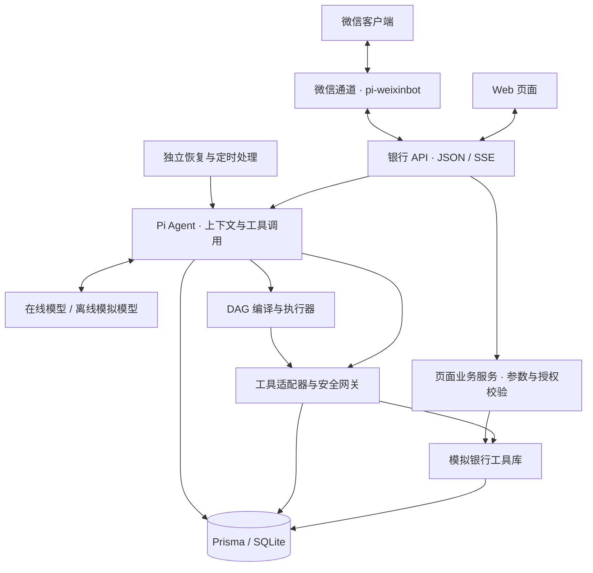
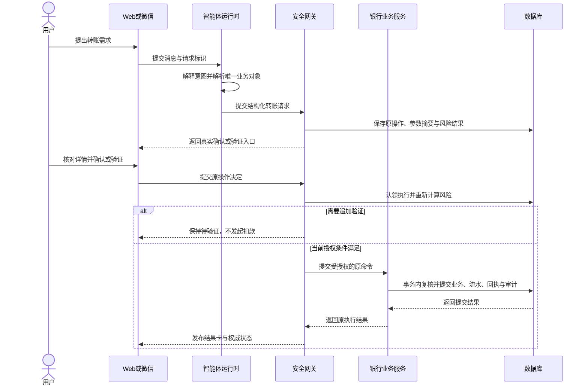
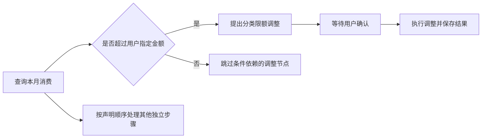

# 万象柜坊 EvoX Omni 技术文档

一坊通万象，一语办万事。

**文档日期**：2026 年 10 月 27 日。

## 1. 项目目标与业务范围

万象柜坊通过自然语言理解金融需求，并把需求转换为可检查、可授权、可恢复的模拟银行操作。用户可从 Web 或微信发起请求，查询与写入复用同一业务数据。

模型解释需求并提出步骤，服务端决定执行权限。银行工具库负责数值计算与业务提交。自然语言中的“已经办理”“直接执行”等表述不具有授权效力。

### 1.1 竞赛场景覆盖

智能转账、账单分析和理财操作均已提供可执行的主要业务流程。演示同时覆盖卡片、订阅和跨场景任务。

| 场景方向 | 当前能力 | 范围说明 |
| --- | --- | --- |
| 智能转账 | 姓名与手机号解析、备注、确认转账、定时转账意图 | 未提供 AA 收款；到期执行仍检查权限 |
| 账单分析 | 月度分类统计、商户汇总、趋势、异常交易识别 | 未提供独立年度报告 |
| 理财操作 | 产品查询与对比、申购、按金额或份额赎回、收益展示 | 未提供投资者风险承受能力问卷 |
| 卡片管理 | 虚拟卡申请、分类限额、临时锁卡、挂失与补办 | 分类限额不调整总授信；全新实体卡创建由页面办理 |
| 订阅管理 | 查询已有订阅、续费提醒设置与取消 | 基于已登记模拟订阅，不从任意流水推断完整订阅关系 |
| 跨场景联动 | DAG 组合查询、条件、预算与定时任务 | 预算为记账记录，不冻结资金，不向真实商户下单 |

### 1.2 演示环境

账户、银行通道和验证码均为模拟服务。Web 使用固定演示用户与共享会话，开发者模式可模拟后台人工核对角色。

业务日期固定为 2026 年 9 月 25 日，时区为 UTC+08:00。账单月份和当日转账累计使用业务日期。认证过期与熔断冷却使用真实时间。

## 2. 系统总体架构

系统按交互、智能体编排、安全控制、银行业务和持久化分层。语言模型不直接操作数据库，也不持有可绕过权限的业务执行入口。



### 2.1 模块职责

| 层次 | 职责 | 主要输出 |
| --- | --- | --- |
| Web 交互层 | 展示对话、结果卡、任务图与确认面板 | 用户请求、确认及验证提交 |
| 微信通道 | 接收绑定用户的文字消息，处理显式操作命令 | 银行 API 请求与结构化回复 |
| 智能体层 | 组织上下文、调用模型、解释本轮用途并调度工具 | 结构化意图、工具调用和解释文字 |
| 规划层 | 校验任务图、排序、条件求值、挂起与恢复 | 节点状态、任务状态和控制结果 |
| 安全层 | 参数、归属、风险、认证、熔断与执行权检查 | 执行许可或类型化拒绝 |
| 银行业务层 | 计算余额、持仓、额度与结算结果 | 业务变更、流水和执行回执 |
| 持久化与审计层 | 保存运行、调用、授权、事务与安全事件 | 可恢复状态与可追踪业务证据 |

主要技术组件为 Next.js 16、React 19、TypeScript、Pi 1.2、Prisma 7 和 SQLite。Pi Core 驱动智能体；Pi Coding Agent 的公开压缩接口用于管理长对话，系统不启动编码会话或注册文件、Shell 工具。

### 2.2 交互与后台处理

Web 通过 JSON 读取业务资料，通过服务器发送事件（SSE）接收工具进度、确认请求和执行结果。页面直接办理的业务由专用接口校验，不依赖模型决定权限。

微信通道作为银行 API 客户端，不直接写入银行数据库。确认、验证、取消和任务控制都提交给银行服务处理，因此渠道转换不会降低业务权限。

Web、恢复处理和定时检查分别运行。Web 提供交互，恢复进程检查中断运行，定时检查生成提醒或到期付款工作流。后台任务不会因 Web 启动而自动运行。

### 2.3 关键数据对象

| 数据对象 | 保存内容 | 用途 |
| --- | --- | --- |
| 账户与流水 | 余额、收支方向、分类、金额和业务时间 | 记账、查询与账单分析 |
| 产品与持仓 | 产品规则、净值、份额、成本和申赎历史 | 估值、结算与收益展示 |
| 卡片与消费记录 | 卡状态、结算账户、限额和消费事实 | 卡片控制及额度校验 |
| 会话与运行 | 原输入、会话版本、模型请求和事件 | 对话归档与中断恢复 |
| 工具调用 | 参数摘要、调用身份、执行键和尝试次数 | 执行追踪与重复请求识别 |
| 待确认操作 | 规范化参数、策略事实、授权及认证状态 | 原操作绑定与执行门控 |
| 执行回执 | 已提交业务的原结果 | 成功事实核验与结果重放 |
| 任务与节点 | 原图、依赖、节点状态和操作关联 | 工作流控制与恢复 |
| 审计与安全事件 | 风险判定、授权、执行结果和异常记录 | 业务追踪与安全分析 |

账户余额和流水金额使用整数分。净值、份额和未舍入估值使用精确十进制文本，避免数据库按二进制浮点保存金融小数。

## 3. 一笔业务的执行流程

以转账为例，请求先转换为明确的收款人、资金账户和金额，再进入确认流程。收到模型回复不代表业务已经执行。



关键检查分布在三个时点：提出操作时解析对象与初判风险；用户确认时检查原操作和当前策略；实际提交时再次核验执行权与业务快照。每个时点只接收该阶段允许的状态。

## 4. 核心算法与业务规则

### 4.1 意图理解、澄清与上下文

系统保留用户原话，并让模型声明当前请求属于咨询、分析、查询或操作。服务端检查用途与工具效果是否一致，咨询和建议不能声明银行写入。

处理过程包括：

1. 结合当前消息、近期完整对话和历史摘要解释需求。
2. 通过查询解析联系人、账户、卡片或持仓。
3. 检查对象是否唯一，以及必需参数是否完整。
4. 对金额、份额、时间或操作对象的歧义发起澄清。
5. 提出单个工具调用，或声明需要编排的工作流。

例如，“给张伟转一笔”需要补充金额；在同一业务语境下补充“200 元”，可结合上下文继续解释。若用户已经切换到其他话题，旧请求不会自动成为待执行队列。

完整历史保存在归档中，摘要只改变模型请求视图。超过上下文预算时，系统按完整轮次压缩旧消息，保留近期原文与工具调用配对。需要准确回忆早期金额或措辞时，可检索原始对话；历史内容不能代替本次授权。

对象名称、手机号和卡尾号用于解析候选。执行最终绑定所属用户的具体资源，不能将展示用掩码当作独立授权证明。多候选时返回安全候选并要求选择，不自动猜测。

### 4.2 DAG 编译与调度

复杂操作可表示为有向无环图（DAG）。每个节点描述工具、参数、依赖、条件与状态，边描述执行先后和成功条件。

编译期检查节点是否唯一、工具是否可用、参数是否完整，以及输出引用是否存在。随后检查循环依赖，并核对写入步骤是否与本轮声明一致。遗漏、额外增加或调换已声明的写操作都会被拒绝。

调度采用拓扑排序。执行器维护前驱与后继关系，在依赖满足后选择可运行节点；同等条件下保留声明顺序。

| 关系或状态 | 执行含义 |
| --- | --- |
| 成功依赖 | 前驱成功后才允许后继执行 |
| 顺序依赖 | 仅要求前驱结束，不把前驱失败当作成功证据 |
| 条件节点 | 用已返回的结构化字段比较用户明确提出的条件 |
| 待确认或待验证 | 保存节点关联并挂起，等待原操作结果 |
| 已成功节点 | 恢复时保留结果，不重复发起成功业务 |
| 失败、取消或锁定 | 按可恢复性决定重试、停止或跳过后继 |

条件中的金额使用精确十进制字符串比较。只有用户明确提出的业务条件才进入图。例如，“查询成功后继续”不能被改为“查询金额大于零后继续”。



计划和节点分别保存状态，待确认操作在创建时记录所属任务与节点。确认完成后，系统把原执行结果写回对应节点，再按原图继续，避免生成替代计划。

### 4.3 转账累计风控

转账始终需要明确确认。金额与累计额均以整数分计算，超过 1000.00 元时进入红色验证流程。

```text
有效累计额 = 当日已入账转出额 + 尚未入账的已授权在途转出额
预计累计额 = 有效累计额 + 本次转账额

本次转账额 > 1000.00 元，或预计累计额 > 1000.00 元：红色
其他有效转账：黄色
```

计算在途金额时，系统核验原操作与执行身份；已入账的同一笔转账不再次计入在途金额。确认与执行阶段都会重新判定，旧的黄色确认不能降低当前红色要求。

例如，初始累计为零，同时准备两笔 600.00 元转账。第一笔取得执行资格后，第二笔计入第一笔的已入账或已授权在途金额。预计累计为 1200.00 元，因此要求验证。

上述保证适用于当前本地事务与数据库约束。多进程争用和多实例部署仍需单独验证。

### 4.4 账单统计与异常识别

账单分析读取已入账流水，按业务月份划定时间窗口。统计对象为非投资类借方流水，包含转账支出；收入和投资申赎不并入该支出总额。

分类汇总采用“分类—金额”映射，商户汇总同时累计金额和笔数，再按金额排序。趋势按连续 6 个月构造，图表坐标允许使用普通数值，金额标签仍保留原始分精度。

异常检测采用确定性规则与已有异常标记：

```text
大额候选 = 支出方向 AND 非投资分类 AND 绝对金额 > 5000.00 元
异常集合 = 已有异常标记记录 ∪ 大额候选
```

大额规则只检查支出，正常工资收入不会仅因金额大而触发该规则。异常提示不等于已确认欺诈，也不会自动冻结无法关联到具体卡片的交易。冻结卡片仍需用户选择对象并完成红色验证。

### 4.5 理财净值、份额与收益

理财采用净值与份额模型，产品查询可对比风险等级、参考年化收益率、期限和起购金额。产品标签不等同于投资者风险承受能力评估。

申购按金额与净值折算份额，份额最多保留 6 位小数。对同一产品再次申购可并入已有持仓，并保存购买记录。

| 计算对象 | 计算口径 |
| --- | --- |
| 持仓市值 | 持仓份额 × 最新净值 |
| 持仓收益 | 持仓市值 − 剩余持仓成本 |
| 持仓收益率 | 持仓收益 ÷ 剩余持仓成本 × 100% |
| 按金额赎回的份额 | 金额 ÷ 净值，向下保留 6 位小数 |
| 赎回到账金额 | 赎回份额 × 成交净值，按 HALF_UP 舍入到分 |
| 赎回消耗成本 | 原剩余成本 × 赎回份额 ÷ 原总份额，舍入到分 |
| 本次已实现收益 | 到账金额 − 本次消耗成本 |
| 累计收益 | 累计已实现收益 + 当前持仓收益 |

例如，赎回 100 份、成交净值为 1.0357 元/份，模拟到账为 103.57 元。到账金额已经包含赎回份额的收益，不再额外加一次收益。

持仓页面同时展示累计收益、持仓收益、持仓收益率、最新净值和持仓份额。净值带业务日期；剩余成本为零时，不计算除零收益率。

赎回必须明确按金额、按份额或全部赎回。超过持仓的请求被拒绝，不截断成可用份额。提交前重新读取持仓与净值，若不再符合授权快照，则要求重新确认。

计算只在份额换算和结算边界使用明确舍入规则。HALF_UP 表示向最近的分舍入，恰好半分时远离零取整。历史数据不足时，不用虚构净值或份额补齐收益。

当前费用口径为模拟零费用。收益为模拟估算，不构成保本或实际收益承诺。

### 4.6 卡片账户绑定与额度约束

借记卡、虚拟卡绑定所属用户的活期账户。卡片展示的是关联账户资金与该卡消费约束，不会因多发一张卡而复制账户余额。

```text
剩余月限额 = 月限额 − 当月已计入消费
当前可支付金额 = min(账户可用余额, 剩余月限额)
未设月限额：按账户可用余额
月限额为零：不可消费
```

消费在事务中复核卡状态、账户归属、余额和月限额，再共同提交扣款、流水与消费记录。挂失或冻结的卡片不能消费。补办前后卡片合并统计同月消费，避免通过补卡重置剩余额度。

信用卡与账户余额分别展示。分类消费限额不修改总授信；补办信用卡继承原授信与当前可用额度，旧挂失卡不重复计入可用授信汇总。

### 4.7 定时意图与到期调度

创建定时记录只保存未来意图，不代表已取得未来转账授权。到期检查先核验用户与会话归属，再原子认领记录，避免重复生成工作流。

提醒类任务写入通知并保存审计，随后标记完成。付款类任务生成关联的转账工作流，进入正常安全网关；需要确认或验证时挂起，等待用户决定，不沿用创建记录时的确认直接扣款。

定时记录状态跟随关联工作流的持久化事实更新。等待用户决定的任务不会阻塞后续到期记录，也不会被后台反复自动批准。

到期判断使用业务时钟。演示时间固定时，需由服务端调度命令显式推进检查时间，不能仅等待现实时间流逝。具体操作见部署与使用说明。

## 5. 可靠执行与持久化恢复

### 5.1 原子提交与稳定执行身份

请求、工具调用、计划节点和待确认操作均具有稳定身份。执行键与参数摘要用于区分同一操作的重放，以及金额、对象发生变化的新操作。

业务提交前使用数据库条件更新认领执行权。在事务内部核验所有者、授权与执行权后，提交业务变更、对应流水、执行回执和必需审计。事务失败时整体回滚，不保留半笔记账结果。

### 5.2 重放与重试

重放返回已经保存的原结果，重试才会重新调用业务服务。两者不能只凭“接口没有收到响应”判断。

| 已知事实 | 恢复策略 |
| --- | --- |
| 有匹配的执行回执 | 返回原结果，不再次扣款或发卡 |
| 查询未完成且当前仍允许执行 | 在次数上限内重试查询 |
| 写入具备可核验的幂等回执能力 | 核验原身份与当前规则后决定是否重试 |
| 尚未确认或验证 | 保留原待决策入口，不自动批准 |
| 无法证明写入是否发生 | 标记待核对，停止自动业务重试 |

模型请求和完整决策先保存，再允许工具执行。不完整、截断或中止的工具参数只保留为事件证据，不能成为银行指令。

### 5.3 中断恢复与执行所有权

系统保存输入检查点、模型请求、工具调用、授权状态和事件顺序。恢复读取原运行及原图，不新建替代操作掩盖不确定结果。

执行租约、会话版本与提交检查共同约束并发执行者。旧执行者失去所有权后，不得继续提交新的金融变更。租约超时是恢复判断条件，不是进程存活证明，因此跨进程与长时间阻塞仍属于验证边界。

## 6. 任务控制、回退与人工接管

| 控制动作 | 当前行为 | 已完成业务的处理 |
| --- | --- | --- |
| 暂停 | 在安全检查点停止启动后继节点 | 保留已完成结果 |
| 继续 | 显式恢复原任务图 | 跳过已成功节点 |
| 取消 | 停止后续步骤并撤销未执行授权 | 不把已入账交易改写为取消 |
| 重试 | 在可证明未提交的条件下重新驱动失败步骤 | 仍检查原身份与授权规则 |
| 回退 | 取消计划后撤销可核实的预算、定时记录 | 已执行资金、理财及卡片变更保留 |
| 人工接管 | 请求停止自动推进并登记人工核对 | 以回执和账本为依据，不用人工说明替代执行证据 |

预算回退只释放仍可撤销的记账预算，定时回退只取消未执行的未来记录。已使用预算、已完成定时任务或归属无法核实的记录返回冲突，避免撤销无关数据。

人工接管可选择停止、恢复或符合条件的重试。在途命令先到达安全检查点，新的自动授权执行受到拦截。结果不明时只能登记核对说明并停止自动处理，不能凭说明认定成功、退款或强行重试。

## 7. 安全设计与结果呈现

安全检查由代码实施。模型给出的权限描述、历史成功记录与用户普通聊天中的确认文字，都不能直接授予执行权。

| 控制目标 | 主要机制 |
| --- | --- |
| 权限分级 | 工具默认策略、动态累计风险和执行时复核 |
| 幻觉防护 | 按原操作绑定工具结果、流水和回执，明确区分成功、失败与待核对 |
| 注入防御 | 检测可疑指令，结合工具白名单、参数约束及服务端权限检查 |
| 操作审计 | 保存风险输入、策略决定、用户授权、执行参数与真实结果 |
| 异常熔断 | 持久化认证失败和已登记的业务失败信号，达到规则阈值后限制调用 |
| 执行隔离 | 只开放注册银行工具，不开放任意 Shell、SQL、文件编辑或代码执行 |
| 数据保护 | 凭据脱敏，普通工具返回使用脱敏号码，完整新卡号经专用接口核验后展示 |

业务结果卡与授权状态来自服务端记录。模型可以解释结果，但不能创建不存在的确认面板，或用一笔成功交易证明另一笔操作成功。对结果未知的业务，不宣称资金未变化。

公开错误使用结构化原因生成用户提示，内部诊断、协议片段和堆栈不直接进入聊天正文。Web 与微信沿用相同的失败事实，渠道只调整展示方式。

当前执行隔离覆盖已注册工具，不包含容器或虚拟机级的生成代码沙箱。红色操作使用模拟验证码，独立员工身份和真实认证服务不在本地演示范围内。

## 8. 验证方法与扩展范围

验证按算法与策略测试、数据库集成、真实浏览器和在线模型场景分层。判断业务成功时，同时关注操作状态、资金或资源变化，以及审计证据，不能只检查回复文字。

当前已完成的选定安全、规划和控制回归结果见[安全自评报告](安全自评报告.md)。mock 模型验证流程可重复性，不能替代在线模型的多轮语义验收。

未来接入真实银行需要增加外部幂等、对账及业务受理状态处理；多实例部署需要补充并发后端与故障恢复验证。新增代码执行能力时，应建立独立的受限执行环境。

## 9. 配套资料

- [安全自评报告](安全自评报告.md)：权限、认证、异常处理、验证结果与风险清单。
- [部署与使用说明](部署与使用说明.md)：安装配置、测试资料、业务演示和备份恢复。
