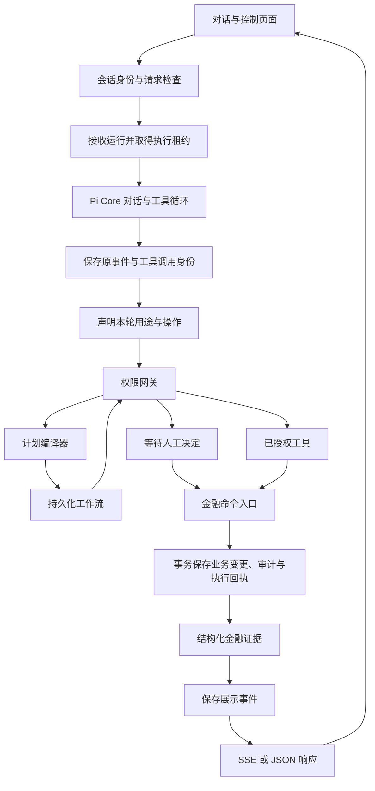

# Architecture Design

**English** | [简体中文](../cn/architecture.md)

The model proposes operations, the server decides authorization, and transactions persist financial facts.
Pi Core handles dialogue and the tool loop.
The server handles permissions, workflow ownership, and financial submission.
Bank accounts, business interfaces, and authentication all use simulated adapters.

For startup commands, see the [Development Guide](development.md).
For field and terminology mappings, see the [Glossary](terms.md).

## Execution Path

SSE refers to the server-sent event stream, and JSON refers to the structured response format.
Query tools return data belonging to the owning user.
Financial writes are committed through public command transactions.
Every tool node in a workflow passes through the permission gateway.

## Module Responsibilities

| Responsibility | Code Entry Point | What It Handles |
| --- | --- | --- |
| HTTP and pages | [app](../../app), [route helper modules](../../app/api/_lib) | Session identity, request validation, status mapping, and transport. |
| Frontend runtime display | [chat](../../components/chat), [runtime](../../components/runtime) | Response validation, streaming cards, and execution control. |
| Interface language | [i18n](../../lib/i18n) | Chinese defaults, bilingual copy, and language selection persistence. |
| Dialogue turn orchestration | [run-turn.ts](../../agent/run-turn.ts), [turn-runtime.ts](../../agent/turn-runtime.ts) | Input lifecycle, run intake, and the Pi runtime. |
| Authorization post-narration | [authorization-resume.ts](../../agent/authorization-resume.ts) | Writes committed results back to the original call, then continues the dialogue. |
| Pi runtime | [banking-agent.ts](../../agent/banking-agent.ts) | Creates the user-bound tool set and installs execution hooks. |
| Turn presentation | [turn-presentation.ts](../../agent/turn-presentation.ts), [turns](../../agent/turns) | Presentation buffering, evidence binding, action cards, and model request control. |
| Write continuation and financial replies | [write-continuation.ts](../../agent/write-continuation.ts), [financial-response.ts](../../agent/financial-response.ts) | Single continuation when a write operation is declared but not committed, and financial replies generated from structured evidence. |
| Run persistence | [durable](../../agent/durable), [agentRun repository](../../lib/db/repositories/agentRun.ts) | Event ordering, call identity, execution leases, and recovery. |
| Tool contracts | [contracts](../../lib/contracts), [tool catalog](../../lib/contracts/tool-catalog.ts) | Names, effects, permissions, replay rules, and public data contracts. |
| Tool adapters | [tools](../../agent/tools) | Parameter schemas and executors bound to the server-side user. |
| Turn declaration and plan compilation | [intent-context.ts](../../agent/intent-context.ts), [turn-intent.ts](../../agent/tools/turn-intent.ts), [plan-compiler.ts](../../agent/tools/plan-compiler.ts) | The purpose of this turn, write operation order, parameter schemas, and node outputs. |
| Workflow execution | [planner](../../planner), [workflows](../../agent/workflows) | Graph state, node claiming, persistence, control, and resumption. |
| Plan failure contracts | [failure.ts](../../planner/failure.ts), [node-outcome.ts](../../planner/node-outcome.ts) | Structured rejection carrying, sealing determination, and node outcome mapping. |
| Authorization and confirmation | [security](../../security), [confirmation](../../agent/confirmation) | Permissions, identity, execution validity, and resumption of the original plan. |
| Identity resolution and masking | [phone.ts](../../lib/phone.ts), [recipient-resolution.ts](../../security/recipient-resolution.ts), [card-resolution.ts](../../security/card-resolution.ts), [mask.ts](../../lib/mask.ts) | Identity determination by full number or the user's own id, candidate narrowing, parameter normalization, and external masking. |
| Security failures and public copy | [security-gateway.ts](../../security/security-gateway.ts), [public-text.ts](../../lib/public-text.ts), [tool-feedback.ts](../../lib/tool-feedback.ts), [public-security-event.ts](../../app/api/_lib/public-security-event.ts), [public-task-text.ts](../../app/schedules/public-task-text.ts) | Structured rejection facts, locked terminal states, and consolidation of all external copy. |
| Scripted model | [mock-responder.ts](../../agent/providers/mock-responder.ts), [mock](../../agent/providers/mock) | Dispatch by intent, parsing, and result narration. |
| Financial command transactions | [command-execution.ts](../../agent/command-execution.ts) | Parameter digests, receipt verification, and atomic commit. |
| Banking business | [banking-sdk](../../banking-sdk), [net-value.ts](../../banking-sdk/net-value.ts) | Resource ownership, exact amount arithmetic, net value and share conversion, and simulated business changes. |
| Data and audit | [lib/db](../../lib/db), [unit-of-work.ts](../../lib/db/unit-of-work.ts), [audit](../../audit) | Repositories, transaction propagation, and persisted records. |
| Manual and scheduling | [manual-review.ts](../../agent/manual-review.ts), [scheduled-dispatcher.ts](../../agent/scheduled-dispatcher.ts) | Manual takeover, reminders, and due payment workflows. |

Routes delegate business execution to the orchestration layer and the banking business layer.
Tool parameter schemas do not grant execution permission.
The banking SDK receives a trusted execution context constructed by the server.

## Database Runtime

Prisma `7.10.1` uses the `prisma-client` generator.
Generated code is located at `lib/db/generated`.
Business code imports types and namespaces from [prisma.ts](../../lib/db/prisma.ts).
Generated code is not committed to Git; run `pnpm db:generate` before deployment.

[prisma.config.ts](../../prisma.config.ts) declares the CLI database address and seed command.
The CLI and the application share [url.ts](../../lib/db/url.ts) to parse the address.
[database.ts](../../lib/db/database.ts) creates a client with a driver adapter.
The adapter uses `@prisma/adapter-better-sqlite3`.
The native driver reads SQLite's `BigInt` amounts as exact integers.
Interest rates and unsettled valuations are still stored as decimal text.

Each client uses an independent native SQLite connection.
Regular queries and transaction entry points share a connection-level queue.
Before a transaction commits or rolls back, regular queries from other requests wait.
This prevents regular writes from joining another request's transaction.
It also prevents regular reads from seeing another request's uncommitted data.
The queue code is in [serialized-connection.ts](../../lib/db/serialized-connection.ts).
Foreign key checks and WAL are enabled when a connection is established.
WAL is SQLite's write-ahead logging mode.
The driver wait, transaction wait, and transaction execution limits are all `10` seconds.
Dates are stored as Unix milliseconds.
Queries within a transaction execute through the same transaction handle.
The global client cannot replace an already-opened transaction handle.
This boundary avoids a single connection waiting on a transaction it holds itself.

Generation, schema synchronization, and mock data seeding are executed separately.
For command responsibilities, see the [Development Guide](development.md#database-management).

## Business Records and Technical Audit

Regular users view operation records via `/activity`.
Developer mode views the operation audit via `/audit`.
Both types of queries use the server-configured user and the shared session.

The business projection is in [operation-history.ts](../../audit/operation-history.ts).
The repository first filters by the business operation name list, then sorts and paginates.
Confirming one's own transaction is a business operation; queries and developer maintenance events are not displayed.
`ActivityRecord` defines only the following fields:

- Event identifier and time.
- Business type.
- Processing status and identity verification status.

The projection does not return tool parameters, results, original requests, or execution control identifiers.
Regular records are displayed per event; no inference is made that different events belong to the same transaction.
Unknown execution results are retained as pending verification, and failed events are retained as incomplete.

The technical audit page and API check developer mode before reading data.
The mode cookie is used for demo preference and does not provide production administrator authentication.
For the API contract, see [activity.ts](../../lib/contracts/activity.ts).

## Dialogue Turns

Each dialogue first obtains an execution identity, then receives model output.
The full archive and the view sent to the model are stored separately.
Pi Coding Agent `1.2.0`'s public `compact()` generates summaries.
The summary prompt and history serialization are provided by the official `compact()`.
The banking adapter layer handles thresholds, recent complete turns, and compaction checkpoints.
Pi Core's request preparation hook first constructs the summary view.
The context transformation hook sends the same view to the model.
The model request log stores this view, and the checkpoint retains the full original messages.
Summaries do not grant execution permission and do not replace the original utterance archive.
When exact wording or precise amounts are needed, the model uses the green archive query tools.
For the rules, see [Context Compression](context-compaction.md).
The model only has access to the current user's banking tools.

1. The [chat route](../../app/api/chat/route.ts) validates the request and loads the fixed demo identity and shared session.
2. The run entry point accepts the request by owning session and acquires an execution lease.
3. The runtime restores the session, resolves the model, and constructs the user-bound tool set.
4. The event recorder subscribes to Pi before the presentation listeners.
5. The model declares the purpose and operations of this turn via `describe_turn`.
6. The runtime checks the declared scope, and the permission gateway checks authorization requirements.
7. The presentation layer generates separate tool records and cards based on structured evidence.
8. On session save, the revision is checked and stale state overwrites are rejected.

The session identifier in the request body is used only for consistency checking.
The web entry point uses the fixed demo user and `demo:${userId}` session.
Different browsers share the saved conversation; the identity cookie does not participate in selection.
The same `requestId` and identical request digest reuse the original run.
When the same identifier is paired with different input, the server rejects the request.

Original Pi events are stored in observed order.
Tool start events and server-side call identities are committed first, then checked or executed.
Externally displayed events are saved first, then returned via SSE or JSON.
The model has no Shell, SQL, or filesystem tools.
Green queries can first determine the operation target and quantity.
Pre-queries that require confirmation use the handling preparation declaration.
After confirmation is read, the full write sequence of the original request can be bound.
Subsequent writes still require separate authorization, and the sequence cannot change again.

Recipients and cards are identified only by full number or the user's exact id.
Masks and last digits only narrow candidates; only after a candidate is unique is a normalized id written; external projections are always masked.
For identity rules, see [Number and Card Identity Resolution](identity-resolution.md).

In online mode, when information is complete but a controlled write call is missing, up to 1 bounded continuations may be appended.
When additional information is needed, the question is retained and the user's answer is awaited.
Erroneous submission statements with missing declarations are also subject to the handling status check.
For continuation and total budget rules, see [Persistence and Recovery](agent-durability.md#single-continuation-for-declared-writes).

A new user message starts a new turn declaration.
The declaration contains the purpose, operation names, and order; the same tool may be declared repeatedly.
The declaration also expresses information completeness via `needsInput`.
Purposes are divided into communication, advice, query, and handling.
Declarations are only used to constrain proposals in this turn and cannot approve financial operations.
Already-saved authorizations continue to use the original operation identity.

Communication may use green queries but cannot create operations requiring authorization.
Advice may request query authorization but cannot submit write operations.
During handling, write tools must belong to this turn's declaration.
When multiple write operations are declared, the complete workflow must be submitted first.
The explicit workflow marker also requires submission through the plan entry point.
Within the same turn, the declaration cannot be changed to another purpose or operation sequence.

Online execution does not extract amounts from user sentences or infer purpose.
The scripted model's natural language scripts are stored only in `providers/mock/`.
The original model text is kept in the internal archive.
User-visible handling status and balances are verified against structured facts.
For complete presentation rules, see [Dialogue and Business Cards](chat-presentation.md#handling-status-and-balance).

## Model Adaptation

The project uses the official packages of Pi `1.2.0`:

- `@earendil-works/pi-agent-core` provides the dialogue and tool loop.
- `@earendil-works/pi-ai` provides model and provider adaptation.
- `@earendil-works/pi-coding-agent` provides the public `compact()`.

The banking runtime calls the SDK's public compaction functions.
Coding Agent's `AgentSession.compact()` belongs to the upper-layer coding session.
The banking session continues to use Prisma; coding tools are not added to the banking registry.
Transitive dependencies of the SDK, such as the command line and terminal interface, are still installed.
For dependency costs, see [Context Compression](context-compaction.md).

For dependency versions, see [package.json](../../package.json).
`resolveProvider()` returns both `model` and `streamFn`.
Both 2 values must be passed when creating an Agent.
`resolveModel()` is used only for viewing models.

Online mode only registers the native adapter of the current provider.
The model catalog is explicitly declared per the providers supported by the project.
Built-in providers include DeepSeek, OpenAI, Anthropic, Google,
Groq, OpenRouter, xAI, Mistral, and Cerebras.
Other compatible providers require an explicitly configured API address.
Script mode creates a separate `fauxProvider()` for each runtime.
Tool parameters and results are converted to JSON data at the Pi boundary.
Keys are read by provider authentication at request time and are not written into model snapshots.

Authorization results need to replace the result message corresponding to the original tool call.
Standalone actions are matched by the original call identifier and tool name.
Workflow actions match the outer `submit_plan`.
When call identifiers are duplicated, the owning call is determined by original authorization, run, and model request.
For pairing logic, see [Authorization Context](../../agent/authorization-context.ts).

## Permissions and Human Decisions

Permissions and tool effects are defined separately and cannot substitute for each other.
The source of definitions is the [Tool Catalog](../../lib/contracts/tool-catalog.ts).

| Dimension | Values | Meaning |
| --- | --- | --- |
| Permission | Green, Yellow, Red | Determines automatic execution, confirmation, and multi-factor authentication requirements. |
| Effect | `read`, `write`, `workflow` | Determines query, financial change, or workflow orchestration. |

Green budget writes still require transactions and auditing.
Yellow subscription queries still require user confirmation.
Transfer permissions are also constrained by amount and cumulative risk rules.

When human authorization is required, the gateway saves `PendingAction`.
The model cannot provide its own approval result.
The confirmation and verification code routes first check whether the resource belongs to the fixed demo user and shared session.
Before execution, the current permissions and execution ownership are checked again.
Multi-factor authentication is abbreviated as MFA.
Circuit breaker locks are partitioned by owner; `resolveBreakerOwner` in [circuit-breaker.ts](../../security/circuit-breaker.ts) resolves the session to `user:<userId>`.
Therefore, another operation on the same account also reports as locked.

Rejection facts are represented by `SecurityFailure`'s `code`, `reason`, and a count.
After verification code failures reach the limit, the operation enters the `locked` terminal state.
`locked` is no longer a pending decision item and does not allow resumption or retry.
This state is written via a source-guarded compare-and-swap; `locked` is never a legal source.
`authorizeWithMfa` always returns a top-level `CIRCUIT_OPEN` for locked accounts.
`failure.code` is `MFA_LOCKED`, and `reason` is `mfa_attempts_exhausted`, indicating that this operation has exhausted its attempts.
`failure.code` is `CIRCUIT_OPEN`, and `reason` is `circuit_open`, indicating that the account circuit breaker was triggered elsewhere.
Both determinations are taken from the operation's own attempt records.
The gateway's `blockReason` is an internal payload and does not enter external-facing text.
`isInternalDiagnostic` in [internal-text.ts](../../lib/internal-text.ts) is the sole determination of internal markers.
Public-facing text is consolidated by [public-text.ts](../../lib/public-text.ts) and [tool-feedback.ts](../../lib/tool-feedback.ts).
For locking and failure rules, see [Security Design](security.md#multi-factor-authentication).

Open manual-review items only block confirmation and verification.
That rejection returns a domain result with `code` as `MANUAL_REVIEW_HOLD` and `reason` as `manual_review_hold`.
Explicit cancellation does not pass through that interception and still writes the original operation as `cancelled`.
During takeover, there are only 1 external-facing messages; for the rules, see [Security Design](security.md#manual-review-takeover).

Permission invalidation, expiration, cancellation, and loss of ownership are determined by the server.
For the rules and the simulated-authentication boundary, see [Security Design](security.md).

## Workflow Compilation and Execution

`submit_plan` performs a compile check first, then saves the workflow.
The compiler checks the following:

- Tool names, dependency relationships, and node output references.
- The number and order of write operations in the declaration.
- Tool parameter types, the owning user's resources, and amount ranges.
- Explicit dates, conditional paths, and output types.

The model submits explicit structured parameters and dependencies.
The compiler does not fill in amounts, objects, or prerequisite dependencies based on the original sentence.
Cards, products, and holdings use actual resource identifiers.
Conditions use explicit query months, comparison operators, and thresholds.

[dag.ts](../../planner/dag.ts) defines directed acyclic graph semantics.
[executor.ts](../../planner/executor.ts) advances node state.
The orchestration adapter provides an authorized executor and persistent checkpoints.
For the rules on node names and output references, see [Banking Tool Contract](tool-contracts.md#write-tools).

The executor claims nodes according to persisted workflow ownership.
Node claiming and subsequent writes check the execution token.
Stale executors cannot overwrite the takeover party's results.
The execution lease is updated at node boundaries.
Takeover still must satisfy the lease-expiration rules.

| Control state | Execution behavior |
| --- | --- |
| Paused | Stops subsequent nodes. |
| Cancelled | Revokes authorizations not yet executed and preserves committed facts. |
| Awaiting authorization | The node waits for the original action's result. |
| Awaiting manual processing | Prohibits new claims and preserves the identity and evidence of commands already started. |
| Resumed | Verifies prerequisite node evidence and continues execution within the original graph. |

Compensation is an explicit workflow operation.
Compensation does not mean that all banking effects can be reversed.
Operator statements also cannot prove that a transfer has been submitted.
For manual takeover rules, see [Manual Review](manual-review.md).
The background reconciliation demo is available only in developer mode.
Card addition and removal use a separate page flow; for the rules, see [Card Management](card-management.md).

## Propagation of Security Rejections

Rejection facts are passed in the following order: gateway, tool result, plan node, runtime settlement, HTTP egress, page rendering.
Each step passes only structured fields; the raw gateway payload does not enter renderable text.
For gateway rejection facts and locking rules, see [Security Design](security.md#multi-factor-authentication).

1. The gateway determines a rejection and returns `SecurityFailure`'s `code`, `reason`, and count.
2. `blockedOutcome` in [gated-execution.ts](../../agent/confirmation/gated-execution.ts) takes only the `failure` parsed from `parseBlockReason` as the external-facing rejection.
3. `publicRefusalMessage` in [outcomes.ts](../../agent/confirmation/outcomes.ts) selects text in a three-level order: when `failure` is present, use `securityNotice`; when only `code` is present, use `publicToolError`; otherwise use `safePublicText`.
4. The plan node carries `PlanFailure` and `actionStatus` in the in-process snapshot and uses them to reject driving the node again.
5. The runtime settles the action's terminal state to the tool call, and HTTP egress returns a status code or domain result according to the error code.
6. Pages and WeChat render only the public-facing text generated by [public-text.ts](../../lib/public-text.ts).

The plan-layer failure contract is in [failure.ts](../../planner/failure.ts).
`PlanFailure` contains `code`, optional `reason`, `actionId`, and count.
`toPlanFailure` copies only typed fields that already exist, and `AppError` retains only `code`.
`isLockedRefusal` is determined based on `reason` or `code` and does not read message text.

Node results carry these two facts via the optional fields `failure` and `actionStatus`.
`settleToolNode` in [node-outcome.ts](../../planner/node-outcome.ts) carries these two fields as-is.
The same mapping uses `publicFailureText` to project `summary` and `error`.
Internal diagnostics therefore are not written into node fields, and business body text is preserved as-is.
Nodes lacking these two fields are not considered sealed.
These two fields are not persisted; the node row stores only `status`, `output`, `error`, and start/end times.
For the write mapping, see `toNodeUpdate` in [task-fencing.ts](../../agent/task-fencing.ts); for the read-back mapping, see `toTaskPlan` in [persistence.ts](../../agent/workflows/persistence.ts).
Seal evidence becomes invalid when the process ends; after a process restart, driving is gated by execution receipts and idempotency constraints.

`SealReason` takes `locked_refusal` or `action_not_open`.
`sealReason` first checks for a lock rejection, then checks whether `actionStatus` no longer belongs to `pending` or `awaiting_mfa`.
`runToolNode` in [executor.ts](../../planner/executor.ts) calls `mayDriveNode` before claiming the node.
Sealed nodes go through `sealNode`, do not call tools, and do not create new pending-decision actions.
`sealNode` only converges the node to `failed`; recorded rejection facts remain unchanged.
Errors thrown by tools are likewise recorded as `failure` and the projected `error`.

`mayResetNode` rejects reset only based on sealed state.
The retry scan in [executor.ts](../../planner/executor.ts) and `retryPlan` in [lifecycle.ts](../../planner/lifecycle.ts) both skip sealed nodes.
When `mayDriveNode` is false, `resumePlan` returns the plan as-is and does not record a stale decision.
`assertParkedActionsNotTerminal` in [parked-actions.ts](../../agent/workflows/parked-actions.ts) performs a read-only check of parked actions before claiming.
This check throws a structured `AppError` when the action is already terminal.
`locked` returns `MFA_LOCKED`; other terminal states return `CONFLICT`.
The check's diagnostic field is written only to `detail`.

`settleInvocationFromAction` in [agentRun.ts](../../lib/db/repositories/agentRun.ts) settles `locked` as `ToolInvocation.status='failed'` and `errorCode='MFA_LOCKED'`.
`locked` is not settled as `needs_reconciliation`, because locking is a known result rather than an unknown submission.
`SETTLED_PENDING_ACTION_STATUSES` contains `locked`; `RUN_BLOCKING_PENDING_ACTION_STATUSES` does not contain `locked`.
Settlement occurs before determining the run's terminal state, so a run containing only lock actions also ends as `failed`.

`STATUS_BY_CODE` in [app/api/_lib/http.ts](../../app/api/_lib/http.ts) maps error codes uniformly:

| Error code | HTTP status |
| --- | --- |
| `MFA_LOCKED`, `CIRCUIT_OPEN` | `423` |
| `SECURITY_DENIED`, `MFA_FAILED` | `403` |
| `CONFLICT` | `409` |
| `VALIDATION` | `400` |
| `NOT_FOUND` | `404` |
| `INSUFFICIENT_FUNDS`, `LIMIT_EXCEEDED` | `422` |
| `TOOL_FAILED` | `502` |
| `INTERNAL` and unknown exceptions | `500` |

Exceptions that are not `AppError` return only `INTERNAL` and a generic message.
The response envelope is `{ ok: true, data }` or `{ ok: false, error }`.

Decision requests on locked actions return domain results, not error envelopes.
`lockedActionRefusal` in [locked-action.ts](../../app/api/_lib/locked-action.ts) returns `200` with `data.ok=false`.
The rejection carries `code='CIRCUIT_OPEN'` and `failure.reason='mfa_session_locked'`.
The rejection text is fixed, contains no verification code, and does not infer the remaining attempt count.
The decision state of `/api/actions` contains only `pending`, `awaiting_mfa`, and `needs_reconciliation`.

Security events are sanitized at egress.
`publicSecurityEvent` in [public-security-event.ts](../../app/api/_lib/public-security-event.ts) preserves the identifier, time, session, type, and severity.
Empty messages or internal diagnostic messages become an empty string; the key itself is preserved.
`detail` is preserved only when it is pure JSON and all string leaves are non-internal-diagnostics; otherwise the entire key is omitted.
Events themselves are never filtered or dropped.
The events of `/api/security` and recent events within the state both go through this projection.

The task read API appends the current state of actions.
[task-pending-actions.ts](../../app/api/_lib/task-pending-actions.ts) supplements nodes with `pendingActionId` with the read-only field `pendingActionStatus`.
This module does not write state and does not supplement the field when the action row is missing.

The conversation flow, confirmation cards, and WeChat bridge all call `securityNotice` and do not concatenate rejection text themselves.
`publicScheduleText` in [public-task-text.ts](../../app/schedules/public-task-text.ts) separately gates the server-side text of `/schedules`.
This function determines solely by `isInternalDiagnostic`, not by `safePublicText`, so business body text is displayed as-is.

## Financial Command Transactions

Financial writes share `executeBankingCommand()`.
Commands use a server-side execution key to bind the tool, user, and parameter digest.
Before reading mutable resources, the command first looks up the original execution receipt.

The original receipt must match the user, tool, parameters, and response evidence.
Transfers additionally require verifying transactions that have already been posted.
When the receipt matches, the original result is returned and the business change is not executed again.

A new write performs the following steps within the same transaction:

1. Acquire the SQLite write lock, then check whether a competing receipt exists.
2. Check the commit validation in the trusted execution context.
3. Execute the banking business change using the current transaction.
4. Save the required audit and the execution receipt for the original response.
5. Complete the associated persisted tool call.

[unit-of-work.ts](../../lib/db/unit-of-work.ts) passes the transaction via `AsyncLocalStorage`.
[execution-context.ts](../../banking-sdk/execution-context.ts) passes the commit validation and audit callback.
Nested SDK and repository operations participate in the same transaction.
Trusted callbacks cannot be supplied by model parameters.
Direct SDK writes also acquire the SQLite write lock before reading a business snapshot.
This avoids using a stale snapshot when a concurrent process upgrades from a read lock.

When required audit fails, the transaction rolls back the business change.
When cancellation commits first, commit validation rejects subsequent business writes.
When the business commits first, subsequent control operations preserve the real result.
If an exception is returned after commit, the result must be restored according to the original evidence.
When evidence is missing or contradictory, execution stops and is transferred to manual review.
For execution evidence rules, see [Persistence and Recovery](agent-durability.md).
For amount and budget rules, see [Financial Values and Settlement](financial-values.md).
Card spending deducts from the settlement demand account's cash and writes a spending transaction.
Debit cards and virtual cards each bind 1 personal demand accounts; cards do not have their own balance.
The payable amount is the lesser of the account's available cash and the remaining monthly limit; multiple cards on the same account share this 1 portion of cash and it is counted only once.
Only `LINKED` binding projects the account name, masked card number, and balance.
`MISSING` and `UNTRUSTED` omit all balance fields and do not report 0.
`FROZEN` and `LOST` preserve the real balance, and `usable` is `false`.
`consume_virtual_card` deducts from the bound demand account within 1 transaction(s) and writes the spending transaction and `CardConsumption`.
The monthly limit is calculated by combining all cards before and after replacement; the spending time is determined by the server, and the same execution key replays the original result.
A replacement card inherits the category limits, and category monthly spending also accumulates along the same card chain.
After replacement, the original card is in the `LOST` terminal state and is not counted toward credit available limit.
For binding, balance display, and data upgrade rules, see [Card Management](card-management.md).

## Persisted Evidence and Recovery

Execution records, authorization records, and financial receipts answer different questions.

| Record | Fact proven |
| --- | --- |
| `AgentRun`, `ModelRequest` | Original input, the complete model request, and the complete decision. |
| `AgentRunEvent`, `ToolInvocation` | Observed events, and the progress of Pi and workflow tool calls. |
| `PendingAction`, workflow records | Manual decisions and current execution ownership. |
| `ExecutionReceipt`, business records, required audit | Committed effects and the original result. |

Logs distinguish original Pi events, execution metadata, and externally displayed events.
Public interfaces provide only security metadata and evidence-bound display content.
Model call identifiers are used only for correlation.
The server generates the actual execution identity.

Recovery preserves the original execution key and tool-call identity.
Committed writes are recovered from verified execution receipts.
Incomplete model output is regenerated from the original request.
Calls in the complete decision that have not started go through normal checks and authorization.
When the execution result is unknown, recovery stops automatic advancement.

Recovery also checks the following conditions:

- Execution lease, retry limit, and backoff time.
- Original provider configuration, current tool permissions, and replay rules.
- Session revision and the original manual decision.
- Original workflow and sub-call identity.

When recovering an incomplete model request, the original tool declaration digest must also be verified.
When the declaration changes, the event recorder rejects resubmission of the original request.
For the check entry point, see [journal.ts](../../agent/durable/journal.ts).

Independent HTTP or scheduled workflows save the `workflow_only` source.
The source record and the workflow are saved in the same transaction.
Recovery uses the original graph and does not call the model to replan.
Workflow recovery allows subsequent conversation revisions to have changed.
Claiming still requires task and session execution ownership to be available.
At task completion, the source log is synchronized.
Completion of a sub-call does not prematurely end the source run.

Pi model continuation and independent workflows share the recovery process.
The project persists logs via Prisma and commits financial command transactions.
For execution rules and the Pi Durable trade-offs, see [Persistence and Recovery](agent-durability.md).

## Investment Subscription and Redemption

Subscriptions and redemptions are handled by [Investment Business](../../banking-sdk/investment.ts) within the same transaction.
Holdings are recorded by net asset value and shares; for the methodology, see [Wealth Management Products](investments.md).
Subscriptions first validate the product minimum investment amount and the account balance, then deduct funds and register the holding.
The shares obtained this time are `FLOOR(金额 ÷ 最新净值, 6 位小数)`.
A further purchase of the same product is merged into the original holding; no new holding is created.
On merging, cost and shares increase simultaneously, and a purchase record is appended.
The additional purchase amount is not counted toward returns.
The holding view returns shares, latest net value, market value, returns, and purchase records.
Market value is derived from `份额 × 最新净值` and is not rounded; `estimatedMarketValue` is retained only as a historical valuation when shares or net value are missing, and is marked pending verification.
When there are no available shares or the product has not published a net value, market value falls back to the remaining cost, and holding returns and cumulative returns are omitted.
Holding returns are unrealized returns; cumulative returns equal realized returns plus holding returns.

Redemption must explicitly specify `mode`: `SHARES`, `AMOUNT`, or `ALL`.
Missing, unknown, or mixed bases, as well as the retired `redeemAmount`, are clarification rather than defaults.
Net value retains 4 decimal places, and shares retain 6 decimal places.
Conversion is a BigInt fixed-point pure function, located in [net-value.ts](../../banking-sdk/net-value.ts).
The credited amount is `HALF_UP(份额 × 成交净值, 人民币分)` and is rounded only once.
`ALL` sets the holding to redeemed; the other two keep it held and deduct shares and remaining cost.
Remaining cost is deducted proportionally to shares and is conserved.
When the confirmation snapshot is inconsistent with the current net value or shares, `CONFLICT` is thrown, requiring re-confirmation.
After the investment write completes, the investment card displays the holding projection re-read after submission, not the snapshot from before the write.
For display conventions, see [wealth management products](investments.md).
For valuation and settlement rules, see [financial values](financial-values.md).
For quote confirmation and replay rules, see [banking tool contract](tool-contracts.md).

## Financial values and time

Credited cash is stored in integer cents using `BigInt`.
Returns and unrounded valuations are computed using `Decimal`.
SQLite stores normalized decimal text.
Remaining holding cost, valuation, and settlement amount are defined separately.

Redemption is rounded to cents at settlement only, per `HALF_UP`.
The execution receipt retains the original quote, rounding rule, and original settlement result.
Public financial inputs and outputs use decimal strings.
`annualYieldRate` represents a dimensionless ratio.
The display layer is responsible for converting ratios to percentages.

Financial conditions use exact decimal comparison.
Counts still use numeric types.
Financial values are converted to JavaScript numbers only when drawing chart coordinates.
For units, boundaries, and check rules, see [financial values](financial-values.md).

The business calendar uses UTC+08:00.
Authorization expiry, execution leases, and run scheduling use real time.
Advancing the demo date does not renew authorization.

## Scheduling and simulation scope

Reminders and their audit records are persisted.
Due payments create or reuse a scheduling workflow and re-request authorization.
Duplicate schedule checks cannot replace user approval.
For scheduling operations, see [scheduled tasks](scheduled-tasks.md).

`reserve_budget` creates a budget limit for bookkeeping.
Budget limits do not freeze withdrawable funds.
Merchant procurement, real SMS, and bank clearing are not yet integrated.
For deployment and business limitations, see [current limitations](known-risks.md).
